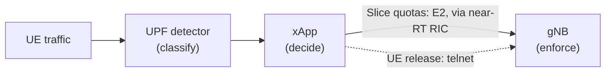

# Exploring the AI-RAN

In this experiment, you will explore AI-for-RAN by bringing up an end-to-end 5G network with a machine learning model that classifies live traffic. You will see:

- how a gNB connects to a near-real-time RAN Intelligent Controller (RIC) over the E2 interface
- how an xApp uses traffic classifications to request changes to slice quotas and release a UE's radio connection
- how a trained machine learning model compares with a hand-written rule and with no defense during a denial-of-service (DoS) attack

You will install the software on an Ubuntu server, build OpenAirInterface (OAI) and FlexRIC from source, and start the network components.

First, you will capture the E2 messages exchanged as the gNB connects to the RIC. Then, you will generate normal traffic and launch an attack from one UE. You will trace one control decision and repeat the experiment with a heuristic classifier and with no defense, comparing the effect on the other UE.

We will run this experiment on the [POWDER testbed](https://powderwireless.net/), using one `d430` server and simulated radio links. You will need to reserve the server several days before you plan to run the experiment, and complete the lab during your reservation.

## Background

A traditional base station comes from one vendor as a closed unit, and the vendor decides how it schedules radio resources. The O-RAN Alliance specifies an open alternative that splits the base station into separate functions, defines the interfaces between them, and adds a controller that outside software can use to observe and steer the RAN. The controller is the RAN Intelligent Controller (RIC), and we will explore its use in this lab.

O-RAN defines two RICs, which differ in how fast their control loops run:

- The **non-real-time RIC** works on timescales longer than one second. It hosts applications called rApps, which set long-term policy and can train ML models.
- The **near-real-time (near-RT) RIC** works on timescales from 10 milliseconds to one second. It hosts applications called xApps, which react to current network conditions. We will work with this kind of RIC.

An xApp can change how the RAN serves its UEs. For example, it can request a handover to move a UE away from a congested cell, or change QoS settings to give a video call priority over a file download. In this experiment, the xApp adjusts slice quotas, which set the share of radio resources that the base station reserves for each slice.

O-RAN specifies the interfaces an xApp can use to control the RAN. The xApp developer chooses how to make control decisions. In this experiment, we will use the output of a machine learning model to decide when to change slice quotas or release a UE's connection. This is an example of AI-RAN, a term for combining AI with the RAN. The AI-RAN Alliance describes three forms:

- **AI-for-RAN:** AI improves the operation of the RAN itself, for example by predicting load or detecting misbehaving users.
- **AI-and-RAN:** AI workloads and RAN workloads share the same computing infrastructure.
- **AI-on-RAN:** the RAN delivers AI services to users and applications at the network edge.

We will explore AI-for-RAN using the code and trained model from Tsourdinis et al. [[1]](#reference-1). They built a system that uses machine learning to detect anomalous traffic and protect an O-RAN 5G network against a denial-of-service (DoS) attack. In this kind of attack, an attacker overwhelms the network with traffic, making it slow or unavailable to legitimate users. The authors evaluated their system on a 5G testbed, comparing the network under attack with the defense enabled and with it disabled.

The 5G network in this lab uses network slicing. We will run two logical networks, called slices, on shared infrastructure, with separate resource settings for each slice. Each UE has its own slice and UPF. A detector inside each UPF uses a machine learning model to classify packets as normal or anomalous, and reports the counts to the xApp. As the anomalous share of a slice's traffic grows, the xApp asks the gNB to lower that slice's quota of downlink radio resources. The attack packets travel uplink, so lowering the downlink quota does not stop them. If the detector reports a window of traffic that is all anomalous, the xApp asks the gNB to release the UE's Radio Resource Control (RRC) connection. A release stops the UE's traffic until it reconnects.



The figure below illustrates the details. FlexRIC implements the near-RT RIC, and an OpenAirInterface (OAI) process runs the gNB. The near-RT RIC talks to the gNB over the E2 interface: the gNB runs an E2 agent that connects to the RIC and advertises the RAN functions it supports. Each function follows an E2 service model, which defines the messages for one kind of interaction. This lab uses the RAN Control (RC) service model, which lets an xApp change settings inside the gNB.


Each slice's quota is its dedicated PRB ratio: the percentage of physical resource blocks (PRBs) the gNB's scheduler sets aside for that slice's UEs. The control xApp changes these quotas by sending a slice-control request, an RC message that the RIC forwards to the gNB over E2 (blue line). The "Traffic detector" box inside each UPF is the model, and the green lines are its reports to the xApp.

We will add a comparison to the paper's experiment. The authors compare their system with the defense enabled and disabled; we will also compare the learned classifier with a hand-written rule. You will run the experiment three times. In the first run, both UPFs use the paper's Random Forest classifier. In the second, both use a heuristic with no learned model. In both runs, the xApp applies the same fixed policy to the detector counts. In the third run, you will turn the defense off. These comparisons let you examine what the classifier contributes, as well as the effect of the defense as a whole.

Note that we will use a model that the authors have trained. You will observe how its classifications of live traffic affect control decisions; you will not train a model during this experiment.


## Run the experiment

### Reserve a server

You will need a [POWDER](https://powderwireless.net/) account with access to your course project. Reserve the hardware several days before you plan to do the lab. In the portal, choose **Experiments → Reserve Resources**, then:

- select the course project and the **Emulab** cluster;
- select **d430** hardware and request **one node**;
- leave the frequency range blank, since this experiment uses RFsim;
- choose a start and end time, allowing 6–12 hours for provisioning, compilation, the exercises, and troubleshooting;
- describe the purpose as learning about AI-RAN in your course.

Click "Check" to confirm availability, then submit the reservation request. Plan to finish and export your work during the reservation.

### Instantiate the profile

At the beginning of your reservation time, open the POWDER profile at the following link:

[https://www.powderwireless.net/p/ece-6323/ai-ran-anomaly-xapp](https://www.powderwireless.net/p/ece-6323/ai-ran-anomaly-xapp)

First, you'll see a brief description of the profile. Click "Next". On the following page, select the "Project" for this course and click "Next".

On the "Schedule" page, look for the reservation you created earlier. The "start" time should be in green, indicating that your reservation has started. Check the box next to your username to fill in the experiment's end time with the end time of your reservation.

Then, click "Finish".

Wait until the server is ready to log in. This can take 10-20 minutes.

- on the "topology view", the server should be green with a check mark in the top right corner
- on the "list view" the status should say "ready" and the startup state should say "Finished"

Then, use SSH to log in to the server.

### Prepare the host environment

> *Note*: Allow about 20-30 minutes for this preparation. You will install and build the software from a base operating system, so that you can use the same tools to set up your own experiments.

First, you will install the tools and build the gNB, software UEs, RIC, and xApp on your server.

Install Docker, the traffic and packet-inspection tools, and a compiler and two libraries that the RIC needs. (If the installation asks whether non-root users should be able to capture packets, choose **No**.)

```bash
sudo apt update
sudo apt install -y docker.io docker-compose-v2 hping3 iperf3 tcpdump tshark \
  gcc-12 libpcre2-dev libsqlite3-dev
sudo usermod -aG docker "$USER"
newgrp docker
```

Download the 5G RAN source code. The 5G RAN in our experiment is implemented in [open source software](https://gitlab.eurecom.fr/oai/openairinterface5g) by the OpenAirInterface project. We will use a specific version that supports slice control, and apply a patch that protects shared slice-control state and handles a release request for a UE whose context is already gone.

```bash
sudo git clone https://gitlab.eurecom.fr/oai/openairinterface5g.git /opt/openairinterface5g
sudo chown -R $USER:$GROUP /opt/openairinterface5g
cd /opt/openairinterface5g
git checkout 50d33e69f0526349ef70ee5b583f099882985276
git apply /local/repository/patches/0001-fix-slice-ctrl-race-and-null-rrc-ctx.patch
```

We will run the RAN in simulated RF mode, with a simulated radio link between the gNB and each UE. Build the RAN from source:

```bash
cd /opt/openairinterface5g
source oaienv
cd cmake_targets
./build_oai -c -C -I --ninja
```

Once this is done, you should see the message

```text
BUILD SHOULD BE SUCCESSFUL
```

That command installs the newest version of the ASN.1 compiler, which OAI uses to generate its signaling-message code. Our version of OAI needs an older one, so replace it:

```bash
cd /tmp/asn1c
git checkout 1d155c232e56a93d31cc80a56ed242ae68a89441
git clean -xdfq
autoreconf -iv
./configure --prefix /opt/asn1c/
make -j`nproc`
sudo make install
```

Then, run

```bash
cd /opt/openairinterface5g/cmake_targets
./build_oai -c -C --gNB --nrUE -w SIMU --build-lib telnetsrv --build-e2 --ninja
```

and again, wait until

```text
BUILD SHOULD BE SUCCESSFUL
```

Build the telnet module. The xApp sets slice quotas over E2, but releases a UE through a separate telnet command. The module that accepts that command comes from a slightly newer OAI version, so build it from there and copy it beside the gNB:

```bash
sudo mkdir /opt/openairinterface5g-telnet
sudo chown -R $USER:$GROUP /opt/openairinterface5g-telnet
cd /opt/openairinterface5g
git worktree add /opt/openairinterface5g-telnet 243c985af86f857c28d14c2bb25e54e223b07a00
cd /opt/openairinterface5g-telnet
cmake -S . -B build -GNinja -DENABLE_TELNETSRV=ON
cmake --build build --target generate_T
cmake --build build --target telnetsrv
cp build/libtelnetsrv*.so /opt/openairinterface5g/cmake_targets/ran_build/build/
```

Download FlexRIC, which implements the near-RT RIC. Add the lab's xApp to its source tree, and apply two patches that fix control-request/acknowledgment ordering races:

```bash
sudo git clone https://gitlab.eurecom.fr/mosaic5g/flexric.git /opt/flexric
sudo chown -R $USER:$GROUP /opt/flexric
cd /opt/flexric
git checkout 7c57a6fb5bc30fe97cdbb534957866cefa92f343
git apply /local/repository/patches/0003-flexric-register-control-before-send.patch
git apply /local/repository/patches/0004-flexric-preserve-early-ack.patch
cp /local/repository/xapp_rc_slice_ctrl.c examples/xApp/c/ctrl/
```

Build and install FlexRIC and the xApp:

```bash
cd /opt/flexric
cmake -S . -B build -GNinja -DCMAKE_C_COMPILER=gcc-12 -DXAPP_MULTILANGUAGE=OFF
cmake --build build
sudo cmake --install build
```

Create the directories for logs and packet captures, and give your user account permission to use them. Logs will go in `/var/log/ai-ran`, and measurements in `/var/tmp/ai-ran`:

```bash
sudo mkdir -p /var/log/ai-ran /var/tmp/ai-ran/captures
sudo chown -R $USER:$GROUP /var/log/ai-ran
sudo chmod 1777 /var/tmp/ai-ran/captures
```

Install our custom FlexRIC `tshark` plugin, by copying it to the directory where `tshark` looks for plugins:

```bash
mkdir -p ~/.local/lib/wireshark/plugins
cp /local/repository/etc/flexric.lua ~/.local/lib/wireshark/plugins/
```

Finally, download the container images for the twelve core services. This includes two custom UPF images that already contain the saved model, its preprocessor, and the feature extraction code:

```bash
cd /local/repository/slicing-cn
docker compose pull
```

### Set up your terminals

For the rest of this experiment, you will need several terminals on the server. You will leave network components and packet captures running in some terminals while you type commands in others. We will use `tmux`, a terminal multiplexer that lets you work with several terminals inside one SSH session. The network and captures will keep running if your SSH connection drops, and you can reconnect to the same session.

Change to the directory where you will save packet captures, and then start a `tmux` session named `lab`. Before each capture or measurement, use the `cd` command shown to select its result directory:

```bash
cd /var/tmp/ai-ran/captures
tmux new -s lab
```

You are now in a `tmux` window. A window fills the whole terminal, like a tab in a browser, and the bar at the bottom lists the number and name of each window. This first window is number 0. We will call it the **main window**, and you will type most commands there.

You will use a separate window for the RIC, gNB, each UE, xApp, and each detector, and leave each component running in the foreground so you can see its output. You can switch windows without interrupting the network. Open a window for packet captures:

```bash
tmux new-window -n capture
```

This opens a new window named `capture` and switches to it. To move between windows, you use key combinations that begin with a prefix, Ctrl+b. Press Ctrl+b, release it, and then press the next key:

| Keys | Effect |
| --- | --- |
| Ctrl+b then a number | Switch to the window with that number |
| Ctrl+b then `w` | Show a list of the windows; choose one with the arrow keys and Enter |
| Ctrl+b then `[` | Scroll back through a window's output with the arrow keys or Page Up; press `q` to stop |
| Ctrl+b then `d` | Detach from `tmux`, leaving everything in it running |

Use Ctrl+b then `0` to return to the main window. To stop a capture or network component, switch to its window and press Ctrl+C.

If your SSH connection drops, or if you detach, log in to the server again and run

```bash
tmux attach -t lab
```

to return to your session. Use your normal account in all windows; commands that require elevated privileges include `sudo`.

### Deploy a 5G core network

Before we begin our exploration of the AI-RAN, we will deploy a 5G core network for the RAN to connect to.

In the main window, use

```bash
docker compose -f /local/repository/slicing-cn/compose.yaml up -d --wait
```

to deploy the 5G core network functions using Docker. At the end, it should say that each container is `Healthy`, for example

```text
 Container oai-upf-slice1  Healthy
 Container oai-upf-slice2  Healthy
```

List the running containers:

```bash
docker ps
```

Example output from `docker ps`:

```text
CONTAINER ID   IMAGE          COMMAND                  CREATED          STATUS                    PORTS                                    NAMES
3b80e797ac5c   2d70f1399931   "/openair-upf/bin/oa…"   20 seconds ago   Up 19 seconds (healthy)   2152/udp, 8805/udp, 8080/tcp             oai-upf-slice1
d1ab08642a37   8254e9b557c4   "/openair-upf/bin/oa…"   20 seconds ago   Up 19 seconds (healthy)   2152/udp, 8805/udp, 8080/tcp             oai-upf-slice2
6587a0ae0b7c   fd533bc2c096   "/openair-smf/bin/oa…"   20 seconds ago   Up 19 seconds (healthy)   80/tcp, 8080/tcp, 8805/udp               oai-smf-slice1
a02a730aadeb   fd533bc2c096   "/openair-smf/bin/oa…"   20 seconds ago   Up 19 seconds (healthy)   80/tcp, 8080/tcp, 8805/udp               oai-smf-slice2
819503e4411e   7e588f0fbfa7   "/openair-amf/bin/oa…"   20 seconds ago   Up 19 seconds (healthy)   80/tcp, 8080/tcp, 9090/tcp, 38412/sctp   oai-amf
2f7f6d6f4ca2   e4f211d9cc88   "/openair-ausf/bin/o…"   21 seconds ago   Up 20 seconds (healthy)   80/tcp, 8080/tcp                         oai-ausf
3b6ae61f341a   5361ca3c9a5b   "/openair-udm/bin/oa…"   21 seconds ago   Up 20 seconds (healthy)   80/tcp, 8080/tcp                         oai-udm
905a2f3d726a   53cdabbce16e   "/openair-nssf/bin/o…"   21 seconds ago   Up 20 seconds (healthy)   80/tcp, 8080/tcp                         oai-nssf
e83254004cc4   1571393477ab   "/openair-udr/bin/oa…"   21 seconds ago   Up 20 seconds (healthy)   80/tcp, 8080/tcp                         oai-udr
3c2924421d08   8d561faf9a13   "/openair-nrf/bin/oa…"   22 seconds ago   Up 22 seconds (healthy)   80/tcp, 8080/tcp, 9090/tcp               oai-nrf-slice12
5f6435dd748f   3f9ab2e401d2   "/bin/bash -c ' ipta…"   23 seconds ago   Up 22 seconds (healthy)                                            oai-ext-dn
a5e86a571a49   7dcddc01f13b   "docker-entrypoint.s…"   23 seconds ago   Up 23 seconds (healthy)   3306/tcp, 33060/tcp                      mysql
```

You should see twelve containers, each marked `healthy`. Your container IDs and times will differ. The `NAMES` column tells you which network function each container runs:

| Component | Role in this experiment |
| --- | --- |
| AMF | Handles UE access and mobility signaling and the gNB's NGAP connection |
| SMFs | Manage the two slices' PDU sessions and configure their UPFs |
| UPFs | Forward user traffic; each custom container also runs a traffic detector |
| External DN | Provides the data-network endpoint used by the software UEs |

There are two SMFs and two UPFs, one of each per slice. The two UPF containers already contain the trained model and the detection scripts from the paper.

### Observe gNB–RIC attachment

The gNB's E2 agent and the near-RT RIC exchange E2 messages over SCTP (Stream Control Transmission Protocol). You will capture this connection as the gNB sets it up.

Open a new `tmux` window for the RIC. In the main window:

```bash
tmux new-window -n ric
```

In the new window, start the RIC:

```bash
sudo /opt/flexric/build/examples/ric/nearRT-RIC
```

Wait until its output contains `Initializing Task Manager`. Then return to the main window with Ctrl+b then `0`, and check that the RIC is listening for SCTP connections on port 36421:

```bash
sudo ss -lnp -A sctp
```

Before you start the gNB, start a capture. Switch to the `capture` window, and run:

```bash
cd /var/tmp/ai-ran/captures
sudo tcpdump -i lo -w connect-ric.pcap 'sctp port 36421'
```

Then return to the main window (Ctrl+b then `0`), and open a new window for the gNB:

```bash
tmux new-window -n gnb
```

In the new window, start the gNB:

```bash
cd /opt/openairinterface5g/cmake_targets/ran_build/build
sudo ./nr-softmodem -O /local/repository/conf/gnb.conf --sa --rfsim -E --gNBs.[0].min_rxtxtime 6 --telnetsrv --telnetsrv.shrmod rrc |& tee /var/log/ai-ran/gnb.log
```

In this command,

- `--sa` selects standalone 5G, and `--rfsim` uses a simulated radio link.
- `-E` and `min_rxtxtime 6` set the sampling rate and processing delay for this deployment.
- `--telnetsrv` and `--telnetsrv.shrmod rrc` load the telnet module that accepts the UE release command.
- `|& tee /var/log/ai-ran/gnb.log` shows the gNB's output in the window and saves a copy, including error messages, in a log file. You will save the UE, xApp, and detector logs in the same way.

The gNB starts its radio stack, connects to the core network, and registers its E2 agent with the RIC. Switch to the `ric` window to see the RIC's side of this. Then return to the main window (Ctrl+b then `0`), and search the gNB log:

```bash
grep -E 'E2 SETUP[- ]RESPONSE|libtelnetsrv_rrc.so successfully loaded' /var/log/ai-ran/gnb.log
```

Repeat this until you see both messages. Then stop the capture with Ctrl+C in the `capture` window, return to the main window, and look at the capture:

```bash
tshark -r connect-ric.pcap
```

Example output:

```text
    1   0.000000    127.0.0.1 → 127.0.0.1    SCTP 122 INIT
    2   0.000098    127.0.0.1 → 127.0.0.1    SCTP 338 INIT_ACK
    3   0.000141    127.0.0.1 → 127.0.0.1    E2 1374 COOKIE_ECHO E2setupRequest  [gNB -> RIC]
    4   0.000216    127.0.0.1 → 127.0.0.1    SCTP 66 COOKIE_ACK SACK (Ack=0, Arwnd=105448)
    5   0.000831    127.0.0.1 → 127.0.0.1    E2 190 E2setupResponse  [RIC -> gNB]
```


> *Note*: `tshark` loads the `flexric.lua` plugin from your plugin directory when it starts. The plugin adds the E2 message names and direction labels shown in this output. It also recognizes FlexRIC's E42 messages between the xApp and the RIC, which you will examine during the attack run.

Both endpoints appear as `127.0.0.1` because the gNB and RIC communicate over the loopback interface on this server. Use the `[gNB -> RIC]` and `[RIC -> gNB]` labels at the end of the line, which come from our plugin, to identify the direction of the E2 messages.

First, the gNB and the RIC set up an SCTP association with a four-message handshake:

| Message | Direction | Purpose |
| --- | --- | --- |
| INIT | gNB → RIC | Requests an association and proposes transport parameters |
| INIT-ACK | RIC → gNB | Returns parameters and an integrity-protected state cookie |
| COOKIE-ECHO | gNB → RIC | Returns the cookie to the RIC |
| COOKIE-ACK | RIC → gNB | Confirms that the cookie was accepted |

The RIC keeps no state for the association until the gNB returns a valid cookie, which protects it from connection requests with a forged source address.

Then, over that association, the gNB sends an E2 Setup request that carries its identity and the RAN functions it supports, and the RIC answers with an E2 Setup response. In the example, the gNB sends the E2 Setup request in the same packet as the COOKIE-ECHO.

To see what an E2 Setup message contains, print the details of the E2 messages:

```bash
tshark -r connect-ric.pcap -Y flexric -O e2ap
```

The response lists the RAN functions that the RIC accepted from the gNB, each with a `ranFunctionID`. (`tshark` marks these two messages as malformed, because FlexRIC uses a newer version of E2 than this `tshark` knows. Most of the fields are still readable.)

**Lab report:** Show the E2 Setup request and response from your capture. Which side sends each one? Which RAN function IDs does the RIC accept in its response? One of them is the RAN Control service model, which the xApp will use. Which one? (You will see its ID again in a later exercise.)

### Attach both UEs

Next, you will attach two software UEs to the network and test that each can reach the external data network.

Each software UE needs its own network namespace. In the main window, create a namespace for UE1, and a pair of virtual Ethernet interfaces that connects it to the host. The UE uses this link to reach the gNB's simulated radio:

```bash
sudo ip netns add ue1
sudo ip link add v-eth1 type veth peer name v-ue1 netns ue1
sudo ip address add 10.201.1.100/24 dev v-eth1
sudo ip link set v-eth1 up
sudo ip -n ue1 address add 10.201.1.1/24 dev v-ue1
sudo ip -n ue1 link set v-ue1 up
sudo ip -n ue1 link set lo up
```

Open a new window for UE1:

```bash
tmux new-window -n ue1
```

In that window, start the UE:

```bash
cd /opt/openairinterface5g/cmake_targets/ran_build/build
sudo ip netns exec ue1 env LD_LIBRARY_PATH=. ./nr-uesoftmodem --rfsimulator.serveraddr 10.201.1.100 -r 106 --numerology 1 --band 78 -C 3619200000 --rfsim --sa -O /local/repository/conf/ue_1.conf -E |& tee /var/log/ai-ran/ue1.log
```

This command tells the UE where to find the gNB's simulated radio (`--rfsimulator.serveraddr`), and sets the radio parameters to match the gNB: 106 resource blocks, numerology 1, band 78, and the carrier frequency. The configuration file has the UE's subscriber identity and its slice.

Return to the main window (Ctrl+b then `0`), and check the UE's addresses:

```bash
sudo ip -n ue1 -br address
```

Repeat this until the `oaitun_ue1` interface has the address **12.2.1.2**. This means that UE1 has attached to the network. Then add a route to the external data network (DN) through that interface, and test it:

```bash
sudo ip -n ue1 route replace 192.168.70.145/32 dev oaitun_ue1
sudo ip netns exec ue1 ping -c 1 192.168.70.145
```

Now create and start UE2. In the main window:

```bash
sudo ip netns add ue2
sudo ip link add v-eth2 type veth peer name v-ue2 netns ue2
sudo ip address add 10.202.1.100/24 dev v-eth2
sudo ip link set v-eth2 up
sudo ip -n ue2 address add 10.202.1.2/24 dev v-ue2
sudo ip -n ue2 link set v-ue2 up
sudo ip -n ue2 link set lo up
```

Open a new window for UE2:

```bash
tmux new-window -n ue2
```

In that window, start the UE:

```bash
cd /opt/openairinterface5g/cmake_targets/ran_build/build
sudo ip netns exec ue2 env LD_LIBRARY_PATH=. ./nr-uesoftmodem --rfsimulator.serveraddr 10.202.1.100 -r 106 --numerology 1 --band 78 -C 3619200000 --rfsim --sa -O /local/repository/conf/ue_2.conf -E |& tee /var/log/ai-ran/ue2.log
```

Return to the main window (Ctrl+b then `0`), and check the UE's addresses:

```bash
sudo ip -n ue2 -br address
```

Wait for the address **12.1.1.130**, then add UE2's route to the DN and test it:

```bash
sudo ip -n ue2 route replace 192.168.70.145/32 dev oaitun_ue1
sudo ip netns exec ue2 ping -c 1 192.168.70.145
```

### Observe xApp–RIC registration

The xApp in this lab controls how the gNB divides its radio resources between the two slices, using the anomaly reports from the UPFs. Before it can do that, it has to register with the RIC.

Open a new window for the xApp. In the main window:

```bash
tmux new-window -n xapp
```

In the new window, start the xApp:

```bash
sudo /opt/flexric/build/examples/xApp/c/ctrl/xapp_rc_slice_ctrl |& tee /var/log/ai-ran/xapp.log
```

The xApp registers with the RIC over FlexRIC's E42 interface, and the RIC tells it which E2 nodes it can control. The xApp then waits for the detectors in the UPFs to connect. Look for `Waiting for incoming connections` in its output.

Once you see that message, return to the main window (Ctrl+b then `0`) to start the detectors.

### Connect the detectors and observe initial slice control

Next, you will start the anomaly detector in each UPF. A detector loads the trained model, captures the UE's packets as they pass through the UPF, and classifies each one. For each packet, it extracts the protocol, the service, the TCP flags and the byte counts, and it gives these features to the Random Forest.

The detector groups its results into windows of 30 packets. Each window advances by ten packets, so consecutive windows overlap by 20. For every window, the detector sends the xApp the number of packets it labeled normal and the number it labeled anomalous. The xApp applies its policy to those counts, and sends control requests to the gNB.

Open a new window for the first detector. In the main window:

```bash
tmux new-window -n ads1
```

In the new window, start the detector in UPF1:

```bash
docker exec -w /app oai-upf-slice1 python3 -u anomaly-detection-server-slice1.py |& tee /var/log/ai-ran/ads1.log
```

Switch to the `xapp` window and look for `Connection accepted from client 1`. Then open a window for the second detector:

```bash
tmux new-window -n ads2
```

In the new window, start the detector in UPF2:

```bash
docker exec -w /app oai-upf-slice2 python3 -u anomaly-detection-server-slice2.py |& tee /var/log/ai-ran/ads2.log
```

Switch to the `xapp` window again and wait for `RC initialization completed`. Then return to the main window (Ctrl+b then `0`). If one of these messages does not appear, look for an error in the detector's window and in the `xapp` window. Each detector connects to the xApp over TCP port 8080 on this server (`192.168.70.1`).

Each control request names two slices and gives a percentage for each. A slice is identified by two numbers, its SST and its SD: slice 1 is SST 1 / SD 1, and slice 2 is SST 1 / SD 5. The percentage is the slice's quota, its dedicated PRB ratio. The xApp sends this first request, with 50% for each slice, as soon as both detectors have connected. It is the starting allocation, and does not depend on any detector report.

From this point on, the xApp uses the detector reports to compute slice quotas. It lowers a slice's quota in proportion to the anomalous share of its traffic. If all packets in a 30-packet window are anomalous, the xApp asks the gNB to release the UE. It sends this release request through the gNB's telnet interface (red dashed line in the figure). The xApp uses the same policy in the Random Forest and heuristic runs.

### Run the experiment with the Random Forest classifier

The network you just started has the Random Forest detector in both UPFs. You will now generate traffic, launch the attack, and measure what happens.

During these measurements you need to watch several things at the same moment: the throughput of both UEs, the CPU use of the UPFs, and the terminal where you start the traffic and the attack. Windows cannot be seen side by side, so you will now split the main window into four panes. Like windows, panes are controlled with Ctrl+b followed by another key:

| Keys | Effect |
| --- | --- |
| Ctrl+b then `%` | Split the current pane into a left and a right pane |
| Ctrl+b then `"` | Split the current pane into a top and a bottom pane |
| Ctrl+b then an arrow key | Move to the pane in that direction |
| Ctrl+b then `z` | Enlarge the current pane to fill the window; repeat to shrink it again |

In the main window, use Ctrl+b then `%` to split it into left and right. Use Ctrl+b then `"` to split the left pane into top and bottom. Then use Ctrl+b then the right arrow key to move to the right pane, and Ctrl+b then `"` to split that one, too. Make your terminal window as large as you can, since each pane only has a quarter of it. When a command's output is wider than its pane, use Ctrl+b then `z` to enlarge the pane, and the same keys to return to four panes.

We will call the top left pane **terminal 1**, the top right pane **terminal 2**, the bottom left pane **terminal 3**, and the bottom right pane **terminal 4**.

| Terminal | Role during measurement |
| --- | --- |
| 1 | UE1 receiver: live throughput |
| 2 | UE2 receiver: live throughput |
| 3 | Docker stats: live UPF CPU |
| 4 | Captures, traffic, attack launch, and xApp log |

You will record 75 seconds of traffic, with a 25-second attack in the middle. The traffic before the attack gives you a baseline. Read through the traffic and attack instructions before starting the senders.

Prepare a directory for the captures and logs from each run. In terminal 4:

```bash
cd /var/tmp/ai-ran/captures
mkdir comparison
mkdir -m 1777 comparison/rf comparison/heuristic comparison/no-defense
```

These commands create one directory for each run, `rf`, `heuristic`, and `no-defense`. Save this run's captures and logs in `comparison/rf`. Mode `1777` lets both `tcpdump` and your own account write files there.

If the `comparison` directory already exists from an earlier attempt, rename it first.

Next, start an `iperf3` receiver in each UE's namespace, so that you can watch the throughput of both UEs. In terminal 1:

```bash
cd /var/tmp/ai-ran/captures/comparison/rf
sudo ip netns exec ue1 iperf3 -s -1 -p 80 --forceflush -f m |& tee ue1-receiver.log
```

In terminal 2:

```bash
cd /var/tmp/ai-ran/captures/comparison/rf
sudo ip netns exec ue2 iperf3 -s -1 -p 80 --forceflush -f m |& tee ue2-receiver.log
```

Each command runs an `iperf3` server inside one UE's namespace. Both should say that they are listening on port 80. Here, `-1` makes the server accept one test and then exit, `--forceflush` makes it print each line of output right away, and `-f m` reports rates in Mbit/s. The server prints one line per second, and `tee` saves a copy in a file.

You will also watch the CPU utilization of both UPFs while the traffic runs. In terminal 3:

```bash
docker stats --format 'table {{.Name}}\t{{.CPUPerc}}' oai-upf-slice1 oai-upf-slice2
```

This shows the name and the CPU utilization of each UPF container, and keeps updating. Note the values now, before any traffic. The paper reports this same metric in its Figure 7.

After starting the captures, you will launch two `iperf3` senders in the external DN container's network namespace. They will send downlink traffic to the UEs for 75 seconds. In the sender commands below:

- `nsenter` runs a command inside another process's namespace, and `DN_PID` is the process ID of the DN container. This ID changes when you restart the core network, which is why the block looks it up each time.
- `-b 100M` asks for 100 Mbit/s, and `-l 1200` writes 1,200 bytes at a time. The simulated radio link carries much less than 100 Mbit/s: in our runs each UE received about 30 Mbit/s.
- `-p` and `--cport` fix the port numbers at both ends, because the detector uses the port as one of its features.
- `timeout -k 3 80` stops a sender that is still running after 80 seconds, which can happen if the gNB releases its UE.

You will also start a ping from UE2 for 75 seconds (`-w 75`), five times per second (`-i 0.2`). The `&` at the end of each traffic command runs it in the background, so the ping and both transfers start at about the same time. Their output goes to files.

Before continuing, check that both receivers are listening on port 80 and the xApp has reported `RC initialization completed`.

Now start two captures, each in its own `tmux` window. Switch to the `capture` window (Ctrl+b then `w` shows a list of the windows), and capture the control messages:

```bash
cd /var/tmp/ai-ran/captures/comparison/rf
sudo tcpdump -i lo -w control.pcap 'sctp port 36421 or sctp port 36422 or tcp port 9090'
```

Return to the main window and open a second capture window:

```bash
tmux new-window -n capture2
```

In this window, capture the detectors' reports. On later runs, reuse this window:

```bash
cd /var/tmp/ai-ran/captures/comparison/rf
sudo tcpdump -i demo-oai -w detector-reports.pcap 'tcp port 8080 and host 192.168.70.1'
```

Return to the main window (Ctrl+b then `0`). In terminal 4, run the following commands to start the ping from UE2 and the two senders, then prepare to launch the attack as described below:

```bash
cd /var/tmp/ai-ran/captures/comparison/rf
DN_PID=$(docker inspect -f '{{.State.Pid}}' oai-ext-dn)
sudo ip netns exec ue2 ping -n -i 0.2 -w 75 192.168.70.145 > ue2-ping.log 2>&1 &
sudo nsenter -t "$DN_PID" -n timeout -k 3 80 iperf3 -c 12.2.1.2 -p 80 --cport 20 -b 100M -l 1200 -t 75 > ue1-sender.log 2>&1 &
sudo nsenter -t "$DN_PID" -n timeout -k 3 80 iperf3 -c 12.1.1.130 -p 80 --cport 80 -b 100M -l 1200 -t 75 > ue2-sender.log 2>&1 &
```

UE1 is the attacker, and UE2 is a legitimate user. UE1 also has its normal download running, so during the attack it sends and receives a mix of normal packets and attack packets. UE1 will send a flood of TCP SYN packets with no payload to the external DN, at a requested rate of 10,000 packets per second for 25 seconds. The gNB and core network must process these packets while serving UE2's traffic. You will measure the effect on UE2's throughput and ping times.

Let the traffic run for **15–20 seconds** first, so that you have a baseline. Then, in terminal 4, launch the attack:

```bash
cd /var/tmp/ai-ran/captures/comparison/rf
date +%s.%N > attack-start.txt
sudo ip netns exec ue1 timeout 25 hping3 -q -S -s 333 -k -p 333 -i u100 -I oaitun_ue1 192.168.70.145 > attack.log 2>&1 &
tail -f /var/log/ai-ran/xapp.log
```

The first command saves the time of the attack, in seconds since 1970, so that you can measure later how long the defense took. The second starts `hping3` in the background. The last shows the xApp's log as it grows, so that you can follow its decisions. At the moment you launch the attack, look at the last line in the two receiver terminals: the interval numbers count the seconds since the traffic started, so this tells you when the attack began within the run. In the `hping3` command,

- `-S` sets the SYN flag, and `hping3` sends no payload unless you ask for one.
- `-s 333` and `-p 333` set the source and destination ports, and `-k` keeps the source port the same for every packet.
- `-i u100` sends one packet every 100 microseconds, which is 10,000 per second. `hping3` may not reach that rate.
- `-I oaitun_ue1` sends the packets through the UE's data interface.
- `timeout 25` ends the attack after 25 seconds.

During the attack, compare the two receiver rates, the UPF CPU utilization, and the xApp's messages. Look for changes to the quotas, and for a release request. A release needs a window in which all 30 packets are anomalous, and UE1's normal download adds normal packets to its windows, so you may not see one.

After the attack stops, do UE2's throughput and the CPU utilization return to their earlier values? If the CPU utilization is lower, is that because the defense worked, or because traffic has stopped?

When the 75 seconds of traffic have finished, press Ctrl+C in terminal 4 to stop following the xApp log, and in terminal 3 to stop `docker stats`. Stop both captures with Ctrl+C in the `capture` and `capture2` windows. Each `tcpdump` prints how many packets it captured and dropped. Then, in terminal 4, save the logs:

```bash
cd /var/tmp/ai-ran/captures/comparison/rf
cp /var/log/ai-ran/{gnb,ue1,ue2,xapp,ads1,ads2}.log .
```

Leave the network running while you examine the results. In terminal 4, check `hping3`'s summary of the attack:

```bash
cd /var/tmp/ai-ran/captures/comparison/rf
cat attack.log
```

Next, look at the end of UE2's ping log. The summary includes the number of packets sent and received, packet loss, and the minimum, average and maximum round-trip time:

```bash
tail -4 ue2-ping.log
```

Find the three largest round-trip times to check for delays that the average may hide:

```bash
grep -o 'time=[0-9.]*' ue2-ping.log | sort -t= -k2 -n | tail -3
```

Now examine the control messages. Look for requests that change the slice quotas, and the acknowledgments that follow:

```bash
tshark -r control.pcap -Y flexric
```

The plugin labels each message's direction and the quotas in each request. Follow one request from the xApp to the RIC over E42 and from the RIC to the gNB over E2, then find the acknowledgments on the return path. To inspect its fields, use:

```bash
tshark -r control.pcap -Y flexric -O flexric,e2ap
```

Compare these requests with the reports from the detectors. Each report is a line of text such as `sst:1,sd:1,normal:20,anomaly:10`. Read the two TCP streams, using the SST and SD to identify each slice:

```bash
tshark -r detector-reports.pcap -Nn -H /local/repository/etc/hosts -q -z follow,tcp,ascii,0
tshark -r detector-reports.pcap -Nn -H /local/repository/etc/hosts -q -z follow,tcp,ascii,1
```

Next, check whether the xApp requested a UE release through the gNB's telnet interface:

```bash
tshark -r control.pcap -q -z follow,tcp,ascii,0
```

A release request looks like `rrc release_rrc 1`, where the number is the gNB's ID for the UE. If the xApp never asked for a release, this capture has no TCP stream, and the command shows nothing. You may see more than one release request for the same UE, each on its own TCP connection: the xApp sends another one when a fully anomalous window comes after a window that was not fully anomalous.

If the capture has no release request, find out why. When the xApp decides to release a UE, it prints `Triggering RRC release` in its log. Check the saved copy of the log for that line, and find the largest number of anomalous packets that the detector reported for UE1 in one window:

```bash
grep 'Triggering RRC release' xapp.log
grep 'Parsed values for client 1' xapp.log | grep -o 'Anomaly: [0-9]*' | sort -t' ' -k2 -n | tail -1
```

The xApp releases a UE only after a window in which all 30 packets are anomalous. If UE1's largest count is below 30, the detector never reported such a window, so the xApp had no reason to release UE1. This is a valid result, and UE2 is likely to be affected as it would be with no defense. Keep the files from this attempt, and repeat the run once. First, move this run's directory aside, and create a new empty directory with the same name:

```bash
cd /var/tmp/ai-ran/captures/comparison
mv rf rf-attempt1
mkdir -m 1777 rf
```

Then follow [Stop the network](#stop-the-network), and start everything again from [Deploy a 5G core network](#deploy-a-5g-core-network) through [Connect the detectors and observe initial slice control](#connect-the-detectors-and-observe-initial-slice-control), with the Random Forest detectors. Skip the captures and the `tshark` commands, as before. When both UEs have their addresses and the `xapp` window shows `RC initialization completed`, repeat the steps above from starting the receivers, using the new `rf` directory. In your report, describe both attempts, and say which one you use in the comparison.

If you find a release request, compare its time with the start of the attack. These commands print both in seconds since 1970:

```bash
cat attack-start.txt
tshark -r control.pcap -Y 'tcp.dstport == 9090 && tcp.len > 0' -T fields -e frame.time_epoch
```

Subtract the attack's start time from the time of the first release request to find how long the defense took to request a release.

To match log lines to packets, you need to compare their times. The host and the UPF containers may use different time zones, so check before you compare:

```bash
date -Is
docker exec oai-upf-slice1 date -Is
```

If the xApp asked for a release, find out whether it took effect. A release ends the UE's radio connection, so the UE can no longer send or receive data. For UE1, that stops the attack, and its normal download too. This is different from a lower quota, which leaves the UE connected with a smaller share of the radio resources.

Look for the release in the logs of both UEs and the gNB. The following command prints matching lines with their file names and line numbers:

```bash
grep -nEi 'release|remov|reestablish|reconnect|error|fail|assert|fatal|segmentation' /var/log/ai-ran/{ue1,ue2,gnb}.log
```

If the gNB released UE1, UE1's log should show that it received an RRC Release, and the gNB's log should show that it removed UE1. Note whether UE1 reconnected. Then test whether each UE can still reach the DN:

```bash
sudo ip netns exec ue1 ping -c 3 -W 1 192.168.70.145
sudo ip netns exec ue2 ping -c 3 -W 1 192.168.70.145
```

If UE1 remains disconnected after a release, its ping should fail, while UE2's should succeed. A failed ping does not tell you why it failed, so use the logs to confirm the release.

**Lab report:** Examine one quota change and the detector reports preceding it. Follow the xApp's control request and acknowledgment on E42 and E2, using frame numbers, times, and supporting log lines. Explain any uncertainty in matching a report to the decision. If the xApp also requested a release, use the UE and gNB logs and connectivity tests to determine whether it took effect. Report the time from the attack's start to the release request, if there was one.

For each slice, the xApp computes `floor(100 × (1 − anomaly_ratio))`. If the two values add up to more than 100, it scales both down and rounds down again. Use this policy to interpret the quota change you trace. The detector waits for a 30-packet window, so the time between reports depends on the traffic rate, even though the RIC is a near-real-time controller.

### Run the experiment with the heuristic

For the second run, you will replace the Random Forest in both UPFs with a hand-written rule, then repeat the traffic, attack, and measurements. You will compare the results to examine how the choice of classifier affects the control decisions and UE performance.

You will change the classifier while keeping the traffic, detector windows, and xApp policy the same:

| Part of the experiment | RF run | Heuristic run |
| --- | --- | --- |
| Classifier inside each UPF | Saved Random Forest and preprocessor | Fixed TCP/flags/byte-count rule |
| Traffic capture and feature extraction | Original UPF detector pipeline | Same pipeline |
| Observation window | 30 packets, advancing by 10 | Same window and step |
| Reporting | Normal/anomaly counts for every computed window | Same format and every-window reporting |
| xApp and enforcement | Fixed quota policy, E42/E2 controls, telnet release path | Same policy and paths |
| Offered workload | Two 75-second downlinks, UE2 ping, one 25-second UE1 SYN attack | Same commands, addresses, ports, and requested rates |

The heuristic script, [`heuristic.py`](https://github.com/nicaeali/ai-ran-lab/blob/main/ai-ran/heuristic.py), runs the paper's detector with one function replaced: the one that labels a packet. It uses three of the features that the detector already extracts (`protocol_type`, `flag`, and the byte counts). It has no trained model, and it does not change during the run.

The rule labels a packet as anomalous when all three of these are true:

1. The packet is TCP.
2. Its payload is at most 14 bytes, not counting the TCP and IP headers.
3. Its TCP flags have SYN set and ACK not set, or have RST set.

It labels every other packet as normal.

A UE sends a SYN packet to start a TCP connection, and can send an RST to reject or abort one. These packets can have no payload. The heuristic labels the attack's SYN packets as anomalous, but it also matches some legitimate traffic:

| Observed packet | Rule's label | Reason |
| --- | --- | --- |
| TCP SYN, 0-byte payload | Anomalous | Small connection attempt without ACK |
| TCP ACK, 4-byte payload | Normal | Neither SYN without ACK nor RST |
| TCP SYN/ACK, 0-byte payload | Normal | ACK excludes the SYN condition; no RST |
| TCP RST/ACK, 0-byte payload | Anomalous | RST satisfies the flag condition even with ACK |
| TCP SYN, 14-byte payload | Anomalous | Payload is at the limit |
| TCP SYN, 15-byte payload | Normal | Payload is above the limit |
| UDP or ICMP | Normal | The TCP condition fails |

In the code, the second condition reads `src_bytes + dst_bytes <= 28`. The detector sets both of these features to the payload length of the one packet it is looking at, so their sum is twice the payload length.

The rule classifies one packet at a time, using its protocol, flags, and payload length. It does not use the packet rate or the attack's address or port. It can therefore label a legitimate TCP connection attempt as anomalous, while labeling a flood of UDP packets as normal.

The rest of the detector is unchanged. It groups the labels into 30-packet windows that advance by ten packets, and reports the counts for every window to the xApp. A window ends when enough packets have arrived, so the time between reports depends on how fast the traffic arrives.

Finish saving and examining the Random Forest results first. Then follow [Stop the network](#stop-the-network), and start everything again from [Deploy a 5G core network](#deploy-a-5g-core-network) through [Observe xApp–RIC registration](#observe-xappric-registration). Skip the captures and the `tshark` commands, as before.

This time, do not start the Random Forest detectors. Copy the heuristic into UPF1, in terminal 3:

```bash
docker cp /local/repository/ai-ran/heuristic.py oai-upf-slice1:/app/heuristic.py
```

Then, in the `ads1` window, run it:

```bash
docker exec -w /app oai-upf-slice1 python3 -u heuristic.py 1 |& tee /var/log/ai-ran/ads1.log
```

Wait until the `xapp` window shows `Connection accepted from client 1`. Then copy the heuristic into UPF2, in terminal 3:

```bash
docker cp /local/repository/ai-ran/heuristic.py oai-upf-slice2:/app/heuristic.py
```

and run it in the `ads2` window:

```bash
docker exec -w /app oai-upf-slice2 python3 -u heuristic.py 2 |& tee /var/log/ai-ran/ads2.log
```

Wait until the `xapp` window shows `RC initialization completed`. In terminal 4, check that both detectors are running the heuristic:

```bash
grep -E 'TCP_FLAG_HEURISTIC|REPORT_INTERVAL_SECONDS' /var/log/ai-ran/ads{1,2}.log
```

Both logs should have a line with `TCP_FLAG_HEURISTIC`, and a line with `REPORT_INTERVAL_SECONDS: 0.0`, which means that the detector reports every window.

Use the same four-pane layout to record this run in `comparison/heuristic`. Start UE1's receiver in terminal 1:

```bash
cd /var/tmp/ai-ran/captures/comparison/heuristic
sudo ip netns exec ue1 iperf3 -s -1 -p 80 --forceflush -f m |& tee ue1-receiver.log
```

Start UE2's receiver in terminal 2:

```bash
cd /var/tmp/ai-ran/captures/comparison/heuristic
sudo ip netns exec ue2 iperf3 -s -1 -p 80 --forceflush -f m |& tee ue2-receiver.log
```

Wait until both receivers are listening on port 80. In terminal 3, start the CPU monitor:

```bash
docker stats --format 'table {{.Name}}\t{{.CPUPerc}}' oai-upf-slice1 oai-upf-slice2
```

In the `capture` window, record the control messages and telnet requests:

```bash
cd /var/tmp/ai-ran/captures/comparison/heuristic
sudo tcpdump -i lo -w control.pcap 'sctp port 36421 or sctp port 36422 or tcp port 9090'
```

In the `capture2` window, record the detector reports:

```bash
cd /var/tmp/ai-ran/captures/comparison/heuristic
sudo tcpdump -i demo-oai -w detector-reports.pcap 'tcp port 8080 and host 192.168.70.1'
```

Return to terminal 4 and start the 75-second ping and downlink transfers:

```bash
cd /var/tmp/ai-ran/captures/comparison/heuristic
DN_PID=$(docker inspect -f '{{.State.Pid}}' oai-ext-dn)
sudo ip netns exec ue2 ping -n -i 0.2 -w 75 192.168.70.145 > ue2-ping.log 2>&1 &
sudo nsenter -t "$DN_PID" -n timeout -k 3 80 iperf3 -c 12.2.1.2 -p 80 --cport 20 -b 100M -l 1200 -t 75 > ue1-sender.log 2>&1 &
sudo nsenter -t "$DN_PID" -n timeout -k 3 80 iperf3 -c 12.1.1.130 -p 80 --cport 80 -b 100M -l 1200 -t 75 > ue2-sender.log 2>&1 &
```

Before the attack, look at both detector logs. Normal TCP traffic includes SYN packets. Does the heuristic label any of them as anomalous? If so, does the xApp change a quota or release a UE before the attack starts?

Wait about as long before launching the attack as you did in the Random Forest run, 15–20 seconds. In terminal 4, start the attack and follow the xApp log:

```bash
date +%s.%N > attack-start.txt
sudo ip netns exec ue1 timeout 25 hping3 -q -S -s 333 -k -p 333 -i u100 -I oaitun_ue1 192.168.70.145 > attack.log 2>&1 &
tail -f /var/log/ai-ran/xapp.log
```

During the attack, follow the counts that UE1's detector reports, and what the xApp does with them. Do the windows contain a mix of normal and attack packets? How do UE2's throughput and ping times change, and the CPU utilization of both UPFs?

After the 75 seconds of traffic, stop following the log with Ctrl+C in terminal 4, stop `docker stats` in terminal 3, and stop both captures in their windows. In terminal 4, save the logs:

```bash
cd /var/tmp/ai-ran/captures/comparison/heuristic
cp /var/log/ai-ran/{gnb,ue1,ue2,xapp,ads1,ads2}.log .
```

Check the attack summary:

```bash
cat attack.log
```

Read UE2's ping summary and find its three largest round-trip times:

```bash
tail -4 ue2-ping.log
grep -o 'time=[0-9.]*' ue2-ping.log | sort -t= -k2 -n | tail -3
```

Inspect the quota changes during this run:

```bash
tshark -r control.pcap -Y flexric
```

Check for release requests on the telnet interface:

```bash
tshark -r control.pcap -q -z follow,tcp,ascii,0
```

If there was a release request, compare its first timestamp with the attack's start time:

```bash
cat attack-start.txt
tshark -r control.pcap -Y 'tcp.dstport == 9090 && tcp.len > 0' -T fields -e frame.time_epoch
```

Use the logs to check whether a release took effect:

```bash
grep -nEi 'release|remov|reestablish|reconnect|error|fail|assert|fatal|segmentation' /var/log/ai-ran/{ue1,ue2,gnb}.log
```

Then test both UEs' connectivity. If UE1's throughput or the CPU utilization dropped, remember that a release also stops UE1's normal download:

```bash
sudo ip netns exec ue1 ping -c 3 -W 1 192.168.70.145
sudo ip netns exec ue2 ping -c 3 -W 1 192.168.70.145
```

You will use this run in the final comparison. Note any false positives, quota changes, or UE releases; you do not need to trace a second decision through the interfaces.

If the xApp did not request a release in this run, repeat the run once, as you did for the Random Forest run. Move `heuristic` aside with `mv heuristic heuristic-attempt1`, create a new `heuristic` directory with `mkdir -m 1777 heuristic`, and restart the network with the heuristic detectors. Then repeat the steps above, and describe both attempts in your report.

### Run the experiment with no defense

For the last run, you will turn the defense off and repeat the traffic and attack, as in the paper's comparison. You will leave the xApp and detectors stopped, so they will not classify traffic, change quotas, or request a UE release. Compare this run with the defended runs to measure the effect of the defense on UE2.

Follow [Stop the network](#stop-the-network). Then start the network again, from [Deploy a 5G core network](#deploy-a-5g-core-network) through [Attach both UEs](#attach-both-ues), skipping the E2 setup capture and the `tshark` commands. Do not start the xApp or the detectors.

Start UE1's receiver in terminal 1, saving the results in `comparison/no-defense`:

```bash
cd /var/tmp/ai-ran/captures/comparison/no-defense
sudo ip netns exec ue1 iperf3 -s -1 -p 80 --forceflush -f m |& tee ue1-receiver.log
```

Start UE2's receiver in terminal 2:

```bash
cd /var/tmp/ai-ran/captures/comparison/no-defense
sudo ip netns exec ue2 iperf3 -s -1 -p 80 --forceflush -f m |& tee ue2-receiver.log
```

Wait until both receivers are listening on port 80. In terminal 3, start the CPU monitor:

```bash
docker stats --format 'table {{.Name}}\t{{.CPUPerc}}' oai-upf-slice1 oai-upf-slice2
```

In terminal 4, start the ping and downlink transfers:

```bash
cd /var/tmp/ai-ran/captures/comparison/no-defense
DN_PID=$(docker inspect -f '{{.State.Pid}}' oai-ext-dn)
sudo ip netns exec ue2 ping -n -i 0.2 -w 75 192.168.70.145 > ue2-ping.log 2>&1 &
sudo nsenter -t "$DN_PID" -n timeout -k 3 80 iperf3 -c 12.2.1.2 -p 80 --cport 20 -b 100M -l 1200 -t 75 > ue1-sender.log 2>&1 &
sudo nsenter -t "$DN_PID" -n timeout -k 3 80 iperf3 -c 12.1.1.130 -p 80 --cport 80 -b 100M -l 1200 -t 75 > ue2-sender.log 2>&1 &
```

After the same 15–20 second baseline, launch the attack in terminal 4:

```bash
date +%s.%N > attack-start.txt
sudo ip netns exec ue1 timeout 25 hping3 -q -S -s 333 -k -p 333 -i u100 -I oaitun_ue1 192.168.70.145 > attack.log 2>&1 &
```

While the attack runs, watch the two receivers and the UPF CPU utilization. No defense will interrupt the 25-second attack. Look at the receivers after it ends, too. If the attack stalls UE2's transfer, the transfer may finish after 75 seconds or the sender may reach its timeout. Wait for the senders to exit before stopping `docker stats`. If a receiver remains waiting after its sender exits, stop it with Ctrl+C and note whether its log contains a summary.

In terminal 4, save the gNB and UE logs:

```bash
cd /var/tmp/ai-ran/captures/comparison/no-defense
cp /var/log/ai-ran/{gnb,ue1,ue2}.log .
```

Check the attack summary:

```bash
cat attack.log
```

Read UE2's ping summary and find its three largest round-trip times:

```bash
tail -4 ue2-ping.log
grep -o 'time=[0-9.]*' ue2-ping.log | sort -t= -k2 -n | tail -3
```

Save UE2's throughput and ping results for comparison with the defended runs.

### Compare the runs

Use the captures and logs from your three runs to compare the following measurements:

- **Throughput.** The `ue1-receiver.log` and `ue2-receiver.log` files in each run's directory have the `iperf3` output, one line per second. Find the typical rate in the 10 seconds before the attack starts and in the 25 seconds following its start. A long interval with a low rate, such as `18.11-28.12 sec ... 0.01 Mbits/sec`, indicates a traffic stall.
- **UE2's ping.** The end of `ue2-ping.log` has the packet loss and the minimum, average and maximum round-trip time. Use the `grep` command from the Random Forest analysis to find the three largest times.
- **Release.** Compare `attack-start.txt` with the release request timestamps in `control.pcap`, as you did when examining the Random Forest results.
- **Quotas.** `tshark -r control.pcap -Y flexric` lists every control request with the quota of each slice.

Keep these points in mind when you interpret the results:

- You have one run of each condition. That shows you how each one behaved this time. It is not enough to conclude that one is better in general.
- A quota is what the xApp asked the gNB to reserve. It is not a measurement of the throughput or of the radio resources that a slice used.
- If a value is missing, say so. Do not treat it as zero.

**Lab report:** Make a table with one column for each run and rows for UE2's throughput before and during the attack, UE2's ping loss and largest round-trip time, and the time from the attack's start to a release request, if any. Describe the quota changes and which UEs lost connectivity. Use logs to distinguish a release from a request for one. If you repeated a run, describe both attempts, and say which one you used.

**Lab report:** Did either defense protect UE2 compared with no defense? What happened to UE1's normal download? Explain why reducing a downlink quota does not stop the uplink attack, and what a release would cost a legitimate user whose traffic the detector mislabeled. Compare the Random Forest with the heuristic: what did the learned classifier add in your runs? Identify the learned and fixed parts of the control loop, and give one legitimate packet the heuristic would label anomalous and one attack it would label normal. State the limits of conclusions based on one run per condition.

### Stop the network

Stop any receiver, capture, or Docker stats command that is still running, with Ctrl+C in its terminal.

Then stop the detectors, UEs, xApp, gNB, and RIC. Switch to each of these windows in turn, and press Ctrl+C in it: `ads1`, `ads2`, `ue1`, `ue2`, `xapp`, `gnb`, `ric`. Leave the windows open, so that you can use them again when you restart the network.

Return to the main window (Ctrl+b then `0`), and run:

```bash
docker compose -f /local/repository/slicing-cn/compose.yaml down
sudo ip link delete v-eth1
sudo ip link delete v-eth2
sudo ip netns delete ue1
sudo ip netns delete ue2
```

The first command removes the core network's containers, including the detectors, which run inside the two UPFs. The others delete the virtual Ethernet links and the namespaces of the two UEs.

Check that the gNB, UEs, RIC, and xApp have stopped:

```bash
pgrep -af '(^|/)(nr-softmodem|nr-uesoftmodem|nearRT-RIC|xapp_rc_slice_ctrl)( |$)'
```

This should print nothing.

If you need to restart the network, reuse each component's existing window; you can use the up arrow key to recall its command. Save the logs first, since restarting overwrites the files in `/var/log/ai-ran`.

### Export your results

After stopping the network, create an archive of your captures and logs, in the main window:

```bash
sudo tar -czf /var/tmp/ai-ran-results.tar.gz -C / var/tmp/ai-ran/captures var/log/ai-ran
sudo chmod 644 /var/tmp/ai-ran-results.tar.gz
```

On your laptop, copy the archive from the server. Use the username and hostname from the SSH command in the POWDER portal:

```bash
scp USER@HOST:/var/tmp/ai-ran-results.tar.gz .
```

This archive has the captures and logs of all three runs. Copy it before your experiment expires, so that you can refer back to these logs when preparing your lab report.

## What to submit

Submit a report with your answers to the following items, in order. Include the output and log lines that support each answer. When you make a claim, say whether you saw it in a captured message, saw it in a log, or inferred it.

1. **E2 Setup.** Show the E2 Setup request and response from your capture. Which side sends each one? Which RAN function IDs does the RIC accept in its response? One of them is the RAN Control service model, which the xApp will use. Which one? (You will see its ID again in a later exercise.)

2. **One control decision.** Examine one quota change in the Random Forest run and the detector reports preceding it. Follow the xApp's control request and acknowledgment on E42 and E2. Include frame numbers, times, and supporting log lines, and explain the quotas using the xApp's policy. Explain any uncertainty in matching a report to the decision. If the xApp also requested a release, use the UE and gNB logs and connectivity tests to determine whether it took effect. Report the time from the attack's start to the release request, if there was one.

3. **Comparison of the runs.** Make a table with one column for each run and rows for UE2's throughput before and during the attack, UE2's ping loss and largest round-trip time, and the time from the attack's start to a release request, if any. Describe the quota changes and which UEs lost connectivity. Use logs to distinguish a release from a request for one. If you repeated a run, describe both attempts, and say which one you used.

4. **Interpretation.** Did either defense protect UE2 compared with no defense? What happened to UE1's normal download? Explain why reducing a downlink quota does not stop the uplink attack, and what a release would cost a legitimate user whose traffic the detector mislabeled. Compare the Random Forest with the heuristic: what did the learned classifier add in your runs? Identify the learned and fixed parts of the control loop, and give one legitimate packet the heuristic would label anomalous and one attack it would label normal. State the limits of conclusions based on one run per condition.


## References

<a id="reference-1"></a>[1] T. Tsourdinis, N. Makris, T. Korakis, and S. Fdida,
"AI-Driven Network Intrusion Detection and Resource Allocation in Real-World
O-RAN 5G Networks," in *Proceedings of the 30th Annual International Conference
on Mobile Computing and Networking (ACM MobiCom)*, 2024, pp. 1842–1849.
[DOI: 10.1145/3636534.3697311](https://doi.org/10.1145/3636534.3697311).
[Code and saved model](https://github.com/teo-tsou/oai-anomaly-detection).
