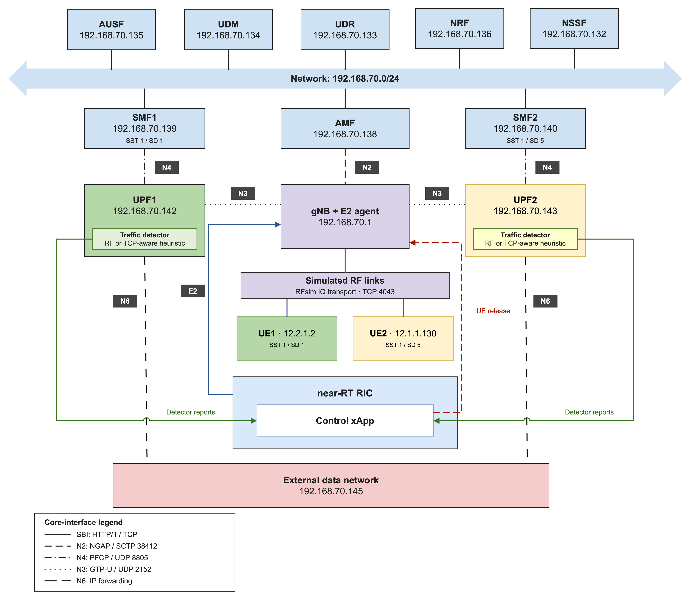

# Exploring the AI-RAN

In this experiment, you will bring up an end-to-end 5G network and follow an AI-assisted control loop. You will observe:

- how a near-real-time RAN Intelligent Controller (RIC) accepts an E2 connection from a gNB;
- how an xApp registers with that RIC and requests RAN slice-resource changes and UE release;
- how a pre-trained ML model operates in the AI-for-RAN control loop in an O-RAN-enabled network.

You will prepare the Ubuntu node, compile OAI and FlexRIC, and then start each network component yourself. The POWDER profile allocates the server; the steps below assemble the software that implements the control loop.

The main experiment explores AI/ML-driven anomaly detection and how it informs RAN slice-resource allocation and Radio Resource Control (RRC) connection-release decisions during a controlled denial-of-service (DoS) attack. The initial connection/capture exercises establish how the system works. You will then perform one Random Forest (RF) run and one heuristic run on live traffic, using the heuristic as a rule-based baseline. You start the traffic and attack yourself, follow the resulting control actions, and compare the live measurements.

The experiment uses one POWDER d430 server and simulated RF links. Reserve the server in advance and complete the exercises during that reservation.

## Background



O-RAN exposes RAN functionality through programmable interfaces and
controllers. A near-RT RIC hosts or supports control applications called xApps. AI-RAN is broader: AI can optimize RAN operation, share infrastructure with RAN workloads, or support AI services through a RAN. This lab demonstrates AI-for-RAN. The concepts used in this lab are summarized in the following bullet points:

- **Denial-of-service (DoS) attack:** An attempt to make a network or service slow or unavailable to legitimate users, often by overwhelming it with traffic.
- **Network slicing:** Creating logical networks, called slices, on shared physical infrastructure, each with its own resource settings and service policies.
- **RRC connection release:** Ending a UE's active radio connection to the gNB, stopping its user-data traffic until it reconnects.

In this lab, we have core network slicing in a way that each UE has its own UPF. An anomaly detector runs in each of the two UPF containers. In the first run, both UPFs use the saved Random Forest [[1]](#reference-1). In the second, both UPFs use a heuristic.

Each method classifies live traffic as normal or anomalous and reports counts to the same slicing xApp. The xApp applies a fixed policy to those counts to allocate resources to each slice; the gNB enforces the requested resource quotas.

This is the deployed inference-and-control part of an AI/ML workflow: capture traffic, extract features, classify packets, report the results, and observe the network's response to control actions. The pre-trained model stays fixed during the experiment. The heuristic run provides a non-ML baseline for the same loop. The roles of classification, decision-making, and enforcement are:

```text
UE traffic → UPF detector (classify) → xApp (decide) → RIC/E2 agent → gNB (enforce)
                                       └──────── telnet release request ────────┘
```

### How the attack, xApp, and heuristic work

**DoS workload.** UE1 acts as the attacker, while UE2 represents a legitimate user. UE1 also carries a legitimate background stream, so its traffic includes both normal and attack packets during the attack period. The live control-loop exercise uses a bounded SYN packet flood: UE1 sends zero-payload TCP SYN packets toward the lab DN at a requested 10,000 packets/s. This creates traffic and processing pressure on the shared radio/core path. We measure whether UE2's throughput and responsiveness degrade. Requested sending rate and achieved rate can differ.

**xApp policy.** Each UPF reports counts of normal/anomalous classifications. The two slices are configured before traffic starts. The xApp uses their anomaly ratios to adjust nominal physical resource block (PRB) allocation ratios. A fully anomalous 30-packet window can trigger a UE release through the separate telnet path. The same xApp policy is used in both comparison arms.

**What a UE release does.** A successful RRC Release removes the UE's active radio connection and interrupts its end-to-end user-data path through the gNB and UPF. Releasing UE1 therefore stops delivery of its attack traffic and its legitimate traffic over that connection. Reducing a slice quota changes its resource allocation; releasing the UE disconnects its active radio path. Correlate the release request with UE/gNB logs, traffic measurements, and reachability checks, and report any reconnection.

**Heuristic.** The rule labels a packet anomalous when it is TCP, has a payload of at most 14 bytes, and has either SYN without ACK or RST set.

**Both the heuristic and RF report every computed window**:
30-packet windows with a ten-packet step (20 packets overlap). Legitimate connection attempts or resets can still trigger false alarms. The heuristic does not flag UDP/ICMP traffic or TCP packets outside its size/flag conditions.

## Run the experiment

### Reserve a server

You will need a [POWDER](https://powderwireless.net/) account with access to your course project. Reserve the hardware several days before you plan to do the lab. In the portal, choose **Experiments → Reserve Resources**, then:

- select the course project and the **Emulab** cluster;
- select **d430** hardware and request **one node**;
- leave the frequency range blank, since this experiment uses RFsim;
- choose a start and end time, allowing 6–12 hours for provisioning, compilation, the exercises, and troubleshooting;
- describe the purpose as learning about AI-RAN in your course.

Click "Check" to confirm availability, then submit the reservation request. Plan to finish and export your work during the reservation.

### Instantiate the profile

At the beginning of your reservation time, open the POWDER profile at the following link:

[https://www.powderwireless.net/p/076958260f1699729ed668ca8ba072839314a485]

First, you’ll see a brief description of the profile. Click “Next”. On the following page, select the “Project” for this course and click “Next”.

On the “Schedule” page, look for the reservation you had created earlier. The “start” time should be in green, indicating that your reservation has started. Check the box next to your username, to automatically fill in the end time of your experiment with the end time of your reservation.

Then, click “Finish”.

Wait until the server is ready to log in. This can take 10-20 minutes.

- on the “topology view”, the server should be green with a check mark in the top right corner
- on the “list view” the status should say “ready” and the startup state should say “Finished”

Then, use SSH to log in to the server.

## Prepare the node

Run these sections in order, one command block at a time. This is the one-time setup for a newly allocated Ubuntu 22.04 node. You will build the FlexRIC and the xApp, OAI gNB and software UEs, and install the tools that observe their interaction. The saved ML model and its inference environment are supplied inside the two UPF images.

### Install the build and networking tools

First install the compilers and libraries used by the native software:

```bash
sudo apt update
sudo apt install build-essential gcc-12 g++-12 cmake ccache \
  autoconf automake libtool bison flex pkg-config git rsync ca-certificates \
  libsctp-dev libpcre2-dev libsqlite3-dev libssl-dev libatlas-base-dev \
  libblas-dev liblapack-dev liblapacke-dev libreadline-dev libconfig-dev \
  zlib1g-dev openssl xxd
```

GCC compiles the RAN and FlexRIC. The configuration and SQLite libraries support the native programs and xApp. GCC 12 avoids the GCC 11.3 C11-generic issue identified by this FlexRIC version.

Next install containers, traffic tools, packet inspection, and host-side Python:

```bash
sudo apt install docker.io docker-compose-v2 iproute2 iptables iputils-ping \
  hping3 iperf3 tcpdump tshark curl python3-venv python3-pip util-linux
sudo systemctl enable --now docker
sudo usermod -aG docker "$USER"
```

Docker will host the 5G core and UPF inference processes. `iproute2` provides separate UE network namespaces. Ping, iperf3, and Hping3 generate the traffic; tcpdump and TShark let you follow its data and control paths. If installation asks, choose **No** for starting an iperf3 daemon and for allowing non-root users to capture packets: you will start the lab's receivers and captures explicitly.

Close this SSH session and reconnect to activate Docker group membership.

### Prepare the workspace and analysis environment

Use your normal SSH account for these steps. Create the lab directories and
give your account ownership of the build trees and logs:

```bash
sudo mkdir -p /opt/ai-ran/bin /opt/asn1c-src /opt/simde \
  /opt/flexric /opt/openairinterface5g /opt/openairinterface5g-telnet \
  /var/log/ai-ran /var/tmp/ai-ran/captures
sudo chown -R "$USER" /opt/ai-ran /opt/asn1c-src /opt/simde \
  /opt/flexric /opt/openairinterface5g /opt/openairinterface5g-telnet \
  /var/log/ai-ran
sudo chmod 1777 /var/tmp/ai-ran/captures
```

`/opt` holds the software builds, `/var/log/ai-ran` holds logs, and
`/var/tmp/ai-ran` holds measurements. Your account can compile the software and
redirect output into the log files. The capture directory also allows tcpdump
to create its files. The lab source stays at `/local/repository`.
If you previously built parts of the lab as root, this ownership step also
lets you continue from your normal account without rebuilding them.

```bash
python3 -m venv /opt/ai-ran/venv
/opt/ai-ran/venv/bin/pip install -r /local/repository/requirements.txt
```

This environment supplies Scapy for packet analysis and Matplotlib for plots. ML inference happens in the UPFs, using the Python packages and saved model already in their images. The host environment is for observing and evaluating the live control loop.

### Build the message compiler and install SIMD headers

OAI generates C code from ASN.1 descriptions of signaling messages, including RRC and NGAP. Use this compiler revision so the generated code matches the OAI source. `git fetch --depth 1` downloads just the specified revision rather than the project's full history; `git checkout FETCH_HEAD` selects that revision.

```bash
git init /opt/asn1c-src
cd /opt/asn1c-src
git fetch --depth 1 https://github.com/mouse07410/asn1c.git 1d155c232e56a93d31cc80a56ed242ae68a89441
git checkout FETCH_HEAD
autoreconf -i
./configure
make -j8
sudo make install
asn1c -version
```

The compiler is installed at its default location, `/usr/local/bin/asn1c`, where OAI can find it. `-j8` uses eight compiler jobs to keep the build manageable.

The SIMDe headers provide vector-instruction support used by OAI's physical layer. They support the radio signal-processing implementation:

```bash
git init /opt/simde
cd /opt/simde
git fetch --depth 1 https://github.com/simd-everywhere/simde-no-tests.git 389f360a66d4a3bec62b7d71ad8be877487809ba
git checkout FETCH_HEAD
sudo rsync -a --exclude=.git /opt/simde/ /usr/local/include/simde/
```

### Download FlexRIC and add the control xApp

FlexRIC implements the near-RT RIC. The C xApp receives classification counts from the two UPFs and converts them into slice-control and UE-release requests. Copying its source into FlexRIC's C examples makes it part of the native build.

```bash
git init /opt/flexric
cd /opt/flexric
git fetch --depth 1 https://gitlab.eurecom.fr/mosaic5g/flexric.git 7c57a6fb5bc30fe97cdbb534957866cefa92f343
git checkout FETCH_HEAD
git apply /local/repository/patches/0003-flexric-register-control-before-send.patch
git apply /local/repository/patches/0004-flexric-preserve-early-ack.patch
cp /local/repository/xapp_rc_slice_ctrl.c examples/xApp/c/ctrl/
cp -r /local/repository/ai-ran/decoder examples/ai-ran-lab
printf '\nadd_subdirectory(examples/ai-ran-lab)\n' >> CMakeLists.txt
```

The patches fix control-request/acknowledgment ordering races. On a single host, an acknowledgment can arrive before the sender finishes bookkeeping. These fixes let you trace the intended **xApp → RIC → gNB → acknowledgment** exchange. The decoder links the same E2AP and RC codecs as FlexRIC, so it can inspect this version's E42 extension and nested slice-control messages.

### Compile and install FlexRIC

```bash
cd /opt/flexric
cmake -S . -B build -DCMAKE_C_COMPILER=gcc-12 -DXAPP_MULTILANGUAGE=OFF
cmake --build build -j8
sudo cmake --install build
cp build/examples/ai-ran-lab/ai_ran_decode_e2 build/examples/ai-ran-lab/ai_ran_decode_rc /opt/ai-ran/bin/
```

The final command installs the two packet decoders used by `inspect-control.py`.
That helper prints short message summaries, including E42 Setup request/response,
and saves the full details beside the PCAP in a `.messages.txt` file.

`cmake` configures the build, `--build` compiles it, and `--install` installs the service-model libraries and default configuration. This lab uses a C xApp, so `XAPP_MULTILANGUAGE=OFF` skips the optional language bindings.

The RC service model carries the slice-control payloads. Inspect the installed controller configuration and the two executables:

```bash
cat /usr/local/etc/flexric/flexric.conf
ls /opt/flexric/build/examples/ric/nearRT-RIC /opt/flexric/build/examples/xApp/c/ctrl/xapp_rc_slice_ctrl
```

The default RIC address is `127.0.0.1`, appropriate for these processes on one
server. Libraries are installed in `/usr/local/lib/flexric/`. The RIC and xApp
will use these defaults when you start them later.

### Compile OAI with the E2 agent

OAI supplies the gNB that enforces radio-resource decisions and the two
software UEs that produce user traffic. Its embedded FlexRIC source provides the gNB-side E2 agent. Initialize that submodule at the revision recorded by the selected OAI commit:

```bash
git init /opt/openairinterface5g
cd /opt/openairinterface5g
git fetch --depth 1 https://gitlab.eurecom.fr/oai/openairinterface5g.git 50d33e69f0526349ef70ee5b583f099882985276
git checkout FETCH_HEAD
git submodule update --init --depth 1 openair2/E2AP/flexric
git submodule status openair2/E2AP/flexric
git apply /local/repository/patches/0001-fix-slice-ctrl-race-and-null-rrc-ctx.patch
```

The patch protects shared slice-control state and handles release requests after a UE context has already been removed.

```bash
cd /opt/openairinterface5g/cmake_targets
CC=gcc-12 CXX=g++-12 ./build_oai --gNB --nrUE --build-e2
```

The three build options select the 5G base station, 5G UE, and E2 agent. `CC`/`CXX` select GCC 12 for this build. This step may take a while.

### Build the RRC-release module

This implementation uses two control paths: E2/RC for slice quotas and a separate telnet command for UE release. The latter needs an RRC telnet module from a compatible OAI revision. A Git worktree checks out that revision beside the main RAN source without changing the source you just built.

```bash
cd /opt/openairinterface5g
git fetch --depth 1 https://gitlab.eurecom.fr/oai/openairinterface5g.git 243c985af86f857c28d14c2bb25e54e223b07a00
git worktree add --detach /opt/openairinterface5g-telnet FETCH_HEAD
cd /opt/openairinterface5g-telnet
CC=gcc-12 CXX=g++-12 cmake -S . -B build -DENABLE_TELNETSRV=ON
cmake --build build --target generate_T -j8
cmake --build build --target telnetsrv -j8
cp build/libtelnetsrv*.so /opt/openairinterface5g/cmake_targets/ran_build/build/
```

The first target generates tracing headers; the second builds the telnet modules. A telnet request asks the gNB to release a UE; you will later verify the resulting radio-state change in the UE and gNB logs.

### Download the core and its inference environment

```bash
cd /local/repository/slicing-cn
docker compose pull
```

Compose downloads the pinned images for the twelve core services. The two custom UPF images contain the saved Random Forest, preprocessor, and original feature-extraction code. This is deployment of an existing inference environment; the model stays fixed while you investigate its control effects. Starting these containers is the next stage of the experiment.

## Start and observe the network

Open **three SSH sessions**: terminals 1 and 2 for captures/logs, and terminal 3 for network processes. Use your normal account in all three terminals; commands that require elevated privileges include `sudo`.

Commands ending in `&` run in the background; `>` saves their output in the named log. Your SSH session creates these log files, even when the program is started with `sudo`, which is why the workspace step makes the log directory writable by your account. Keep the sessions open while their processes run. Repeat each readiness check until its expected message or address appears before moving to the next step.

### Start the core

In terminal 3:

```bash
cd /local/repository/slicing-cn
docker compose up -d --wait
```

Compose now creates the 5G core and waits for its dependencies to become healthy. The AMF will accept the gNB's NGAP connection, the SMFs will establish UE sessions, and the UPFs will forward the packets that the detectors classify. List the running containers:

```bash
docker ps
```

Example output from `docker ps`:

```text
CONTAINER ID   IMAGE          COMMAND                  CREATED          STATUS                    PORTS                                    NAMES
3b80e797ac5c   2d70f1399931   "/openair-upf/bin/oa…"   20 seconds ago   Up 19 seconds (healthy)   2152/udp, 8805/udp, 8080/tcp             oai-upf-slice1
d1ab08642a37   8254e9b557c4   "/openair-upf/bin/oa…"   20 seconds ago   Up 19 seconds (healthy)   2152/udp, 8805/udp, 8080/tcp             oai-upf-slice2
6587a0ae0b7c   fd533bc2c096   "/openair-smf/bin/oa…"   20 seconds ago   Up 19 seconds (healthy)   80/tcp, 8080/tcp, 8805/udp               oai-smf-slice1
a02a730aadeb   fd533bc2c096   "/openair-smf/bin/oa…"   20 seconds ago   Up 19 seconds (healthy)   80/tcp, 8080/tcp, 8805/udp               oai-smf-slice2
819503e4411e   7e588f0fbfa7   "/openair-amf/bin/oa…"   20 seconds ago   Up 19 seconds (healthy)   80/tcp, 8080/tcp, 9090/tcp, 38412/sctp   oai-amf
2f7f6d6f4ca2   e4f211d9cc88   "/openair-ausf/bin/o…"   21 seconds ago   Up 20 seconds (healthy)   80/tcp, 8080/tcp                         oai-ausf
3b6ae61f341a   5361ca3c9a5b   "/openair-udm/bin/oa…"   21 seconds ago   Up 20 seconds (healthy)   80/tcp, 8080/tcp                         oai-udm
905a2f3d726a   53cdabbce16e   "/openair-nssf/bin/o…"   21 seconds ago   Up 20 seconds (healthy)   80/tcp, 8080/tcp                         oai-nssf
e83254004cc4   1571393477ab   "/openair-udr/bin/oa…"   21 seconds ago   Up 20 seconds (healthy)   80/tcp, 8080/tcp                         oai-udr
3c2924421d08   8d561faf9a13   "/openair-nrf/bin/oa…"   22 seconds ago   Up 22 seconds (healthy)   80/tcp, 8080/tcp, 9090/tcp               oai-nrf-slice12
5f6435dd748f   3f9ab2e401d2   "/bin/bash -c ' ipta…"   23 seconds ago   Up 22 seconds (healthy)                                            oai-ext-dn
a5e86a571a49   7dcddc01f13b   "docker-entrypoint.s…"   23 seconds ago   Up 23 seconds (healthy)   3306/tcp, 33060/tcp                      mysql
```

All twelve rows show running, healthy containers. Use `NAMES` to identify the services; `IMAGE` shows image IDs in this example. Your container IDs and elapsed times will differ.

The custom UPFs already contain the model and original anomaly-detection scripts. The core uses two SMFs/UPFs with
distinct slices.

The core separates control-plane functions from packet forwarding. Identify these roles in the container list:

| Component | Role in this experiment |
| --- | --- |
| AMF | Handles UE access and mobility signaling and the gNB's NGAP connection |
| SMFs | Manage the two slices' PDU sessions and configure their UPFs |
| UPFs | Forward user traffic; each custom container also runs a traffic detector |
| External DN | Provides the data-network endpoint used by the software UEs |

**Lab report:** save the command/output showing core health. Identify the AMF, NRF, two SMFs, two UPFs, and external-DN container. State which components run ML inference and which will enforce RAN changes.

### Observe gNB–RIC attachment

SCTP (Stream Control Transmission Protocol) carries E2 signaling between the gNB's E2 agent and the near-RT RIC. You will capture this connection as it forms.

In terminal 3, make the log directory and any existing log files writable by your account. This also handles files created during an earlier root-shell run:

```bash
sudo chown -R "$USER" /var/log/ai-ran
```

The `>` redirection is performed by your normal SSH session before `sudo` runs the program. Your account therefore needs write permission on the log path.

Start the RIC:

```bash
sudo stdbuf -oL -eL /opt/flexric/build/examples/ric/nearRT-RIC > /var/log/ai-ran/ric.log 2>&1 &
```

After a moment, inspect its startup log and SCTP listeners:

```bash
cat /var/log/ai-ran/ric.log
sudo ss -lnp -A sctp
```

The RIC is the control-plane intermediary between the xApp and the gNB's E2 agent. `stdbuf` makes log output appear promptly. Wait until its log contains `Initializing Task Manager` and `ss` shows an SCTP listener on port 36421. Repeat these checks if startup is still in progress. Before starting the gNB, capture in terminal 1:

```bash
sudo tcpdump -i lo -w /var/tmp/ai-ran/captures/connect-ric.pcap 'sctp port 36421'
```

Watch the RIC log in terminal 2:

```bash
tail -f /var/log/ai-ran/ric.log
```

Start the gNB in terminal 3:

```bash
cd /opt/openairinterface5g/cmake_targets/ran_build/build
sudo stdbuf -oL -eL ./nr-softmodem -O /local/repository/conf/gnb.conf --sa --rfsim -E --gNBs.[0].min_rxtxtime 6 --telnetsrv --telnetsrv.shrmod rrc > /var/log/ai-ran/gnb.log 2>&1 &
```

Check the actual gNB log in terminal 3:

```bash
grep -E 'E2 SETUP[- ]RESPONSE|libtelnetsrv_rrc.so successfully loaded' /var/log/ai-ran/gnb.log
```

Wait for both messages. The gNB starts its radio stack, connects to the core, and registers its E2 agent with the RIC. `--sa` selects standalone 5G; `--rfsim` uses simulated RF; `-E` and `min_rxtxtime 6` select this deployment's sampling and processing timing. `--telnetsrv` and `--telnetsrv.shrmod rrc` enablethe separate RRC-release endpoint. Then wait two seconds and stop the capture and live log stream with Ctrl+C in their respective terminals. Inspect the saved capture:

```bash
tshark -r /var/tmp/ai-ran/captures/connect-ric.pcap -Y sctp
/opt/ai-ran/venv/bin/python /local/repository/ai-ran/inspect-control.py /var/tmp/ai-ran/captures/connect-ric.pcap
```

Here is an example log:
```text
    1   0.000000    127.0.0.1 → 127.0.0.1    SCTP 122 INIT
    2   0.000093    127.0.0.1 → 127.0.0.1    SCTP 338 INIT_ACK
    3   0.000136    127.0.0.1 → 127.0.0.1    SCTP 1374 COOKIE_ECHO DATA (TSN=0)
    4   0.000221    127.0.0.1 → 127.0.0.1    SCTP 66 COOKIE_ACK SACK (Ack=0, Arwnd=105448)
```

There are two setup operations to distinguish. SCTP establishes the
transport association; E2 Setup exchanges the gNB identity and supported RAN functions over that association. The SCTP handshake has four messages:

| Message | Direction | Purpose |
| --- | --- | --- |
| INIT | gNB → RIC | Requests an association and proposes transport parameters |
| INIT-ACK | RIC → gNB | Returns parameters and an integrity-protected state cookie |
| COOKIE-ECHO | gNB → RIC | Returns the cookie to the RIC |
| COOKIE-ACK | RIC → gNB | Confirms that the cookie was accepted |

The cookie lets the listener defer full association state until the peer returns a valid token, helping resist spoofed connection requests. SCTP setup alone does not establish that the E2 application exchange succeeded; find the E2 Setup request and response as well.

**Lab report:** show the SCTP INIT/INIT-ACK/COOKIE-ECHO/COOKIE-ACK exchange and the E2 Setup request/response.

### Attach both UEs and observe the data path

SCTP also carries NGAP signaling between the gNB and AMF. You will observe this
signaling as the UEs attach to the network.

Capture in terminal 1:

```bash
sudo tcpdump -i demo-oai -w /var/tmp/ai-ran/captures/connect-ues.pcap 'sctp port 38412 or udp port 2152'
```

Each software UE needs its own network namespace. In terminal 3, create UE1's
namespace and a veth pair for its RFsim connection to the host:

```bash
sudo ip netns add ue1
sudo ip link add v-eth1 type veth peer name v-ue1 netns ue1
sudo ip address add 10.201.1.100/24 dev v-eth1
sudo ip link set v-eth1 up
sudo ip -n ue1 address add 10.201.1.1/24 dev v-ue1
sudo ip -n ue1 link set v-ue1 up
sudo ip -n ue1 link set lo up
cd /opt/openairinterface5g/cmake_targets/ran_build/build
sudo ip netns exec ue1 env LD_LIBRARY_PATH=. stdbuf -oL -eL ./nr-uesoftmodem --rfsimulator.serveraddr 10.201.1.100 -r 106 --numerology 1 --band 78 -C 3619200000 --rfsim --sa -O /local/repository/conf/ue_1.conf -E > /var/log/ai-ran/ue1.log 2>&1 &
sudo ip -n ue1 -br address
```

Repeat the address check until `oaitun_ue1` has **12.2.1.2**. Add the DN route
and test it before starting UE2:

```bash
sudo ip -n ue1 route replace 192.168.70.145/32 dev oaitun_ue1
sudo ip netns exec ue1 ping -c 1 192.168.70.145
```

Now create and start UE2 in terminal 3:

```bash
sudo ip netns add ue2
sudo ip link add v-eth2 type veth peer name v-ue2 netns ue2
sudo ip address add 10.202.1.100/24 dev v-eth2
sudo ip link set v-eth2 up
sudo ip -n ue2 address add 10.202.1.2/24 dev v-ue2
sudo ip -n ue2 link set v-ue2 up
sudo ip -n ue2 link set lo up
sudo ip netns exec ue2 env LD_LIBRARY_PATH=. stdbuf -oL -eL ./nr-uesoftmodem --rfsimulator.serveraddr 10.202.1.100 -r 106 --numerology 1 --band 78 -C 3619200000 --rfsim --sa -O /local/repository/conf/ue_2.conf -E > /var/log/ai-ran/ue2.log 2>&1 &
sudo ip -n ue2 -br address
```

Wait for **12.1.1.130**, then add UE2's DN route and test it:

```bash
sudo ip -n ue2 route replace 192.168.70.145/32 dev oaitun_ue1
sudo ip netns exec ue2 ping -c 1 192.168.70.145
```

The UE command selects the gNB's RFsim address, 106 resource blocks, numerology 1, band 78, and the matching carrier frequency. Its configuration supplies the subscriber identity and slice. Attachment establishes the user-data path that will later carry both legitimate traffic and the DoS workload.

Stop the capture with Ctrl+C. Inspect it:

```bash
tshark -r /var/tmp/ai-ran/captures/connect-ues.pcap -Y ngap
```

Example output (selected lines from one UE's attachment):

```text
    5  11.818365 192.168.70.1 → 192.168.70.138 NGAP/NAS-5GS 150 InitialUEMessage, Registration request
    6  11.838297 192.168.70.138 → 192.168.70.1 NGAP/NAS-5GS 146 SACK (Ack=0, Arwnd=106496) , DownlinkNASTransport, Authentication request
    7  11.874852 192.168.70.1 → 192.168.70.138 NGAP/NAS-5GS 142 SACK (Ack=0, Arwnd=106496) , UplinkNASTransport, Authentication response
    8  11.897005 192.168.70.138 → 192.168.70.1 NGAP/NAS-5GS 126 SACK (Ack=1, Arwnd=106496) , DownlinkNASTransport, Security mode command
   10  11.948907 192.168.70.138 → 192.168.70.1 NGAP/NAS-5GS 266 SACK (Ack=2, Arwnd=106496) , InitialContextSetupRequest
   11  12.045378 192.168.70.1 → 192.168.70.138 NGAP 98 SACK (Ack=2, Arwnd=106496) , InitialContextSetupResponse
   18  13.267431 192.168.70.138 → 192.168.70.1 NGAP/NAS-5GS 278 SACK (Ack=6, Arwnd=106496) , PDUSessionResourceSetupRequest
   19  13.335810 192.168.70.1 → 192.168.70.138 NGAP 118 SACK (Ack=3, Arwnd=106496) , PDUSessionResourceSetupResponse
```

Here, `192.168.70.1` is the gNB and `192.168.70.138` is the AMF. These selected lines show registration, authentication, security setup, and context/PDU session setup for one UE. Your frame numbers and timestamps will differ.

Next, inspect the GTP-U packets carrying ICMP:

```bash
tshark -r /var/tmp/ai-ran/captures/connect-ues.pcap -Y 'gtp and icmp' -V
```

Example output (selected fields from UE1's ICMP echo request):

```text
Frame 24: 142 bytes on wire (1136 bits), 142 bytes captured (1136 bits)
Internet Protocol Version 4, Src: 192.168.70.1, Dst: 192.168.70.142
User Datagram Protocol, Src Port: 2152, Dst Port: 2152
GPRS Tunneling Protocol
    Message Type: T-PDU (0xff)
    TEID: 0x00000001 (1)
Internet Protocol Version 4, Src: 12.2.1.2, Dst: 192.168.70.145
Internet Control Message Protocol
    Type: 8 (Echo (ping) request)
```

The outer IP header carries the GTP-U tunnel from the gNB (`192.168.70.1`) to UPF1 (`192.168.70.142`) over UDP port 2152. Inside it, the original IP packet carries UE1's ping from `12.2.1.2` to the DN at `192.168.70.145`.

**Lab report:** show one UE's attachment-related NGAP exchange and one GTP-U packet carrying ICMP. Identify outer tunnel endpoints and inner UE/DN IPs. Explain why identical interface names in two namespaces do not conflict.

### Observe xApp–RIC registration

Remember that an xApp is a control application deployed on the near-RT RIC platform. In this lab, the xApp controls radio-resource allocation for the two network slices based on the UPFs' anomaly reports. We will first observe the protocol exchanges when xApp registers to a RIC.

Capture in terminal 1:

```bash
sudo tcpdump -i lo -w /var/tmp/ai-ran/captures/connect-xapp.pcap 'sctp port 36422'
```

Start the xApp in terminal 3:

```bash
sudo stdbuf -oL -eL /opt/flexric/build/examples/xApp/c/ctrl/xapp_rc_slice_ctrl > /var/log/ai-ran/xapp.log 2>&1 &
```

After a moment, read that log in terminal 3:

```bash
cat /var/log/ai-ran/xapp.log
```

The xApp registers through FlexRIC's E42 interface and learns which E2 nodes it can control. It then listens for UPF classification reports. Look for `Waiting for incoming connections` in the printed log. If startup is still in progress, repeat the `cat` command; start the xApp only once.

After that message appears, wait another two seconds, then stop the capture with Ctrl+C in terminal 1. Inspect it:

```bash
tshark -r /var/tmp/ai-ran/captures/connect-xapp.pcap -Y sctp
/opt/ai-ran/venv/bin/python /local/repository/ai-ran/inspect-control.py /var/tmp/ai-ran/captures/connect-xapp.pcap
```

Example output (relevant lines from the control decoder):

```text
Frames [3]  t=0.000142s  127.0.0.1:46494 -> 127.0.0.1:36422  E42setupRequest
Frames [5]  t=0.000699s  127.0.0.1:36422 -> 127.0.0.1:46494  E42setupResponse
```

**Lab report:** show E42 Setup request/response.

### Connect the detectors and observe initial slice control

Starting each anomaly detector loads the pre-trained model and preprocessor, captures UE packets at its UPF, and extracts features for inference. It reports window counts to the xApp. Start these two captures first so you can see how inference processes join the control loop and trigger the initial allocation.

The extractor produces protocol, service, TCP-flag, and byte-count features. The saved preprocessor converts them into the representation expected by the trained Random Forest. Predictions are aggregated into the overlapping windows described above. The xApp sees those **normal/anomalous counts**, applies its fixed control policy, and sends requests toward the gNB. Your measurements then evaluate the resulting network behavior, completing the inference–control–observation loop.

Terminal 1:

```bash
sudo tcpdump -i lo -w /var/tmp/ai-ran/captures/detector-control.pcap 'sctp port 36421 or sctp port 36422'
```

Terminal 2:

```bash
sudo tcpdump -i demo-oai -w /var/tmp/ai-ran/captures/detector-connect.pcap 'tcp port 8080 and host 192.168.70.1'
```

Terminal 3:

```bash
docker exec -w /app oai-upf-slice1 python3 -u anomaly-detection-server-slice1.py > /var/log/ai-ran/ads1.log 2>&1 &
```

The detector's output goes to `ads1.log`; the connection confirmation is written by the xApp to `xapp.log`. Display that log and follow new lines in terminal 3:

```bash
tail -n +1 -f /var/log/ai-ran/xapp.log
```

This shows existing log lines as well, so you can see the confirmation even if it has already appeared. When you see `Connection accepted from client 1`, press Ctrl+C to stop the log view. The background detector and xApp keep running. Then start the second detector:

```bash
docker exec -w /app oai-upf-slice2 python3 -u anomaly-detection-server-slice2.py > /var/log/ai-ran/ads2.log 2>&1 &
```

Watch the xApp log again:

```bash
tail -n +1 -f /var/log/ai-ran/xapp.log
```

When you see `RC initialization completed`, press Ctrl+C in terminal 3 to stop
the log view. Then stop the captures with Ctrl+C in terminals 1 and 2.
Run each detector startup command only once; if a confirmation does not appear,
inspect `ads1.log`, `ads2.log`, and `xapp.log` for errors before retrying.
Inspect the saved captures:

```bash
tshark -r /var/tmp/ai-ran/captures/detector-connect.pcap -Y tcp
/opt/ai-ran/venv/bin/python /local/repository/ai-ran/inspect-control.py /var/tmp/ai-ran/captures/detector-control.pcap
cat /var/tmp/ai-ran/captures/detector-control.pcap.messages.txt
```

Example output (selected TCP fields; options omitted):

```text
1   0.000000 192.168.70.142 → 192.168.70.1   TCP 74 38274 → 8080 [SYN] Seq=0 Win=64240 Len=0
2   0.000057 192.168.70.1   → 192.168.70.142 TCP 74 8080 → 38274 [SYN, ACK] Seq=0 Ack=1 Win=65160 Len=0
3   0.000088 192.168.70.142 → 192.168.70.1   TCP 66 38274 → 8080 [ACK] Seq=1 Ack=1 Win=65536 Len=0
4  18.326928 192.168.70.143 → 192.168.70.1   TCP 74 58876 → 8080 [SYN] Seq=0 Win=64240 Len=0
5  18.326987 192.168.70.1   → 192.168.70.143 TCP 74 8080 → 58876 [SYN, ACK] Seq=0 Ack=1 Win=65160 Len=0
6  18.327015 192.168.70.143 → 192.168.70.1   TCP 66 58876 → 8080 [ACK] Seq=1 Ack=1 Win=65536 Len=0
```

Frames 1–3 establish UPF1's detector connection from `192.168.70.142:38274` to the xApp at `192.168.70.1:8080`. Frames 4–6 establish UPF2's connection from `192.168.70.143:58876` to the same xApp endpoint.

Example output (initial control exchange):

```text
Frames [27]  t=25.868014s  127.0.0.1:46494 -> 127.0.0.1:36422  E42RICcontrolRequest
Frames [28]  t=25.868300s  127.0.0.1:36421 -> 127.0.0.1:58928  RICcontrolRequest
Frames [29]  t=25.869208s  127.0.0.1:58928 -> 127.0.0.1:36421  RICcontrolAcknowledge
Frames [30]  t=25.869531s  127.0.0.1:36422 -> 127.0.0.1:46494  RICcontrolAcknowledge
```

Frames 27–28 carry the request **xApp → RIC → gNB**; frames 29–30 return the acknowledgment **gNB → RIC → xApp**. In the detailed output, `ricRequestorID` changes from `1` on the xApp-facing connection to `1021` on the gNB-facing connection, then back to `1` in the acknowledgment to the xApp. Both requests use `RANfunctionID = 3` and carry the same control payload.

The helper also decodes the nested RC control message. Parameter IDs 8 and 9 identify SST/SD which defines the slices, and ID 12 carries the dedicated PRB policy ratio. This initial 50/50 allocation is a configured default, not an inference result. The next exercise observes changes driven by actual detector reports.

The relevant decoded values in frames 27 and 28 are:

| Slice | SST (parameter 8) | SD (parameter 9) | Requested dedicated PRB ratio (parameter 12) |
| --- | --- | --- | --- |
| Slice 1 | `31` → ASCII `1` | `31` → ASCII `1` | `50` → 50% |
| Slice 2 | `31` → ASCII `1` | `35` → ASCII `5` | `50` → 50% |

The SST/SD values above are hexadecimal bytes, while the ratio is an integer. These are nominal allocation requests, not measured radio utilization. Frame numbers and relative times belong to their respective PCAP files; use absolute timestamps when correlating across captures.

**Lab report:** identify both detector TCP connections, then follow the initial control request from xApp to RIC and from RIC to gNB, including acknowledgments. Find the two nominal 50/50 quotas. Request IDs can be translated between the two interfaces; correlate endpoints, timing, service, and payload as well.

### RF (Random Forest) run: operate the measurements and observe the AI loop

Use the network you just started with RF detectors in both UPFs. Stop the earlier captures and open a **fourth SSH terminal**. First, use steps A–D to practice observing normal traffic. Then step E preserves those observations, resets the network, and starts a fresh timed RF attack run. The later heuristic run uses the same timed workload and xApp policy. Each measured run includes its own pre-attack baseline.

| Terminal | Role during measurement |
| --- | --- |
| 1 | UE1 receiver: live throughput |
| 2 | UE2 receiver: live throughput |
| 3 | Docker stats: live UPF CPU |
| 4 | Captures, traffic, attack launch, and xApp log |

The practice session has 75 seconds of normal traffic and no attack. You can
review its saved output for as long as you need afterward. Each measured run
then has a new 75-second traffic period and one 25-second attack. Read all of
step E before starting that timed run.

#### A. Prepare the result directory

In terminal 4:

```bash
mkdir /var/tmp/ai-ran/captures/comparison
mkdir -m 1777 /var/tmp/ai-ran/captures/comparison/rf /var/tmp/ai-ran/captures/comparison/heuristic
ln -s rf /var/tmp/ai-ran/captures/comparison/current
```

These commands create one directory per method. Initially, `current` selects
`rf` for the practice session. Step E moves these recordings to `rf-practice`
and creates an empty `rf` directory for the measured run. The same measurement
commands will later be used with `current` pointing to `heuristic`.
Mode `1777` lets tcpdump and your regular account write their files.
Create this directory once per pair. If it already exists, export and rename
the previous directory before starting another pair; the recorder refuses to
overwrite an existing recording.

#### B. Start the two receivers

In terminal 1:

```bash
sudo ip netns exec ue1 stdbuf -oL -eL iperf3 -s -1 -B 12.2.1.2 -p 80 -i 1 --forceflush -f m 2>&1 | python3 /local/repository/ai-ran/record.py /var/tmp/ai-ran/captures/comparison/current/ue1-receiver.jsonl
```

In terminal 2:

```bash
sudo ip netns exec ue2 stdbuf -oL -eL iperf3 -s -1 -B 12.1.1.130 -p 80 -i 1 --forceflush -f m 2>&1 | python3 /local/repository/ai-ran/record.py /var/tmp/ai-ran/captures/comparison/current/ue2-receiver.jsonl
```

Both should say they are listening on port 80. `record.py` displays the original output and saves each line with its observation timestamp; `iperf3` performs the measurement. The recorder uses only Python's standard library.


#### C. Observe UPF utilization

In terminal 3:

```bash
docker stats --format '{{.Name}} {{.CPUPerc}}' oai-upf-slice1 oai-upf-slice2 | python3 /local/repository/ai-ran/record.py /var/tmp/ai-ran/captures/comparison/current/cpu.jsonl
```

You will see each UPF's name and CPU percentage. Record the idle values
before the traffic starts. This is container CPU utilization, the resource metric used in paper Figure 7.

#### D. Observe normal traffic — practice session

Use this session to learn what the receiver, CPU, and detector outputs look like during normal traffic. Let the transfers finish without launching an attack.

In terminal 4, start these two bounded captures. `&` leaves them running while you enter the next command; the two logs retain their capture/drop counts.

```bash
sudo timeout -s INT -k 3 95 tcpdump -i lo -n -U -w /var/tmp/ai-ran/captures/comparison/current/control.pcap 'sctp port 36421 or sctp port 36422 or tcp port 9090' > /var/tmp/ai-ran/captures/comparison/current/capture.log 2>&1 &
sudo timeout -s INT -k 3 95 tcpdump -i demo-oai -n -U -w /var/tmp/ai-ran/captures/comparison/current/detector-reports.pcap 'tcp port 8080 and host 192.168.70.1' > /var/tmp/ai-ran/captures/comparison/current/detector-capture.log 2>&1 &
```

Confirm both logs show `listening on` before proceeding:

```bash
cat /var/tmp/ai-ran/captures/comparison/current/capture.log
cat /var/tmp/ai-ran/captures/comparison/current/detector-capture.log
```

Run the following commands promptly, one by one. The first records a timestamp only. The next three start the actual ping and TCP traffic:

```bash
date +%s.%N > /var/tmp/ai-ran/captures/comparison/current/traffic-start.txt
sudo ip netns exec ue2 ping -n -D -O -i 0.2 -W 1 -w 75 192.168.70.145 > /var/tmp/ai-ran/captures/comparison/current/ue2-ping.log 2>&1 &
sudo nsenter -t "$(docker inspect -f '{{.State.Pid}}' oai-ext-dn)" -n timeout -s INT -k 3 80 iperf3 -c 12.2.1.2 -p 80 --cport 20 -b 100M -l 1200 -t 75 -i 1 -J > /var/tmp/ai-ran/captures/comparison/current/ue1-sender.json 2>&1 &
sudo nsenter -t "$(docker inspect -f '{{.State.Pid}}' oai-ext-dn)" -n timeout -s INT -k 3 80 iperf3 -c 12.1.1.130 -p 80 --cport 80 -b 100M -l 1200 -t 75 -i 1 -J > /var/tmp/ai-ran/captures/comparison/current/ue2-sender.json 2>&1 &
```

`nsenter` runs the host's iperf client in the external DN's network namespace. These are two downlink streams, each capped at a requested 100 Mbit/s, using 1,200-byte application write buffers. Actual goodput may be much lower.

**Observe during the 75-second practice session:** watch both receiver rates and UPF CPU. Read the latest classifications in terminal 4:

```bash
tail -n 12 /var/log/ai-ran/ads1.log
tail -n 12 /var/log/ai-ran/ads2.log
tail -n 12 /var/log/ai-ran/xapp.log
```

Record normal-traffic throughput, CPU, and nominal quotas. Are any legitimate packets classified as anomalous? Keep any false alarms, releases, or faults in your practice observations.

After the transfers finish, run this in terminal 4 to wait for its background jobs, including the 95-second captures:

```bash
wait
```

Press Ctrl+C in terminals 1, 2, and 3 if a receiver or the CPU recorder is still running. Then save the practice logs in terminal 4:

```bash
date +%s.%N > /var/tmp/ai-ran/captures/comparison/current/end.txt
cp /var/log/ai-ran/{gnb,ric,ue1,ue2,xapp,ads1,ads2}.log /var/tmp/ai-ran/captures/comparison/current/
```

You can now review the recorded output and discuss your observations without a running measurement timer.

**Lab report:** report both UEs' normal-traffic throughput, each UPF's CPU utilization, and the nominal slice quotas. Are any legitimate packets classified as anomalous? Use excerpts from the detector and xApp logs to show whether those classifications lead to quota changes or an unintended UE release. Do not assume that normal traffic must produce perfect classifications.

#### E. Start a fresh run and launch the attack

##### E1. Preserve practice data and reset the network

After completing step D and stopping its recorders, run these commands once in
terminal 4. `rf-practice` must not already contain an earlier practice session:

```bash
mv -T /var/tmp/ai-ran/captures/comparison/rf /var/tmp/ai-ran/captures/comparison/rf-practice
mkdir -m 1777 /var/tmp/ai-ran/captures/comparison/rf
```

The `current` symlink still points to `rf`, which is now empty. The practice
recordings are preserved in `rf-practice` and are excluded from the final
RF/heuristic comparison.

In terminal 3, use [Stop the network](#stop-the-network). Then repeat the
startup commands and readiness checks from [Start the core](#start-the-core)
through [Connect the detectors and observe initial slice control](#connect-the-detectors-and-observe-initial-slice-control),
using **RF detectors in both UPFs**. The connection-capture and inspection
exercises were already completed; only restart the components and check their
readiness here. Wait for both UE addresses and `RC initialization completed`.

This restart gives the measured run fresh UE IDs, detector windows, and quotas,
and clears the previous connections on the fixed iperf3 ports.

##### E2. Start the timed measurements

Restart **both receivers** by repeating [step B](#b-start-the-two-receivers) in
terminals 1 and 2. Wait until both show that they are listening on port 80.
Restart the **CPU recorder** using [step C](#c-observe-upf-utilization) in terminal 3.
These commands now write fresh files in the selected measurement directory.

In terminal 4, start fresh captures:

```bash
sudo timeout -s INT -k 3 95 tcpdump -i lo -n -U -w /var/tmp/ai-ran/captures/comparison/current/control.pcap 'sctp port 36421 or sctp port 36422 or tcp port 9090' > /var/tmp/ai-ran/captures/comparison/current/capture.log 2>&1 &
sudo timeout -s INT -k 3 95 tcpdump -i demo-oai -n -U -w /var/tmp/ai-ran/captures/comparison/current/detector-reports.pcap 'tcp port 8080 and host 192.168.70.1' > /var/tmp/ai-ran/captures/comparison/current/detector-capture.log 2>&1 &
```

Confirm that both captures are listening:

```bash
cat /var/tmp/ai-ran/captures/comparison/current/capture.log
cat /var/tmp/ai-ran/captures/comparison/current/detector-capture.log
```

Start a new 75-second traffic period, including both **DN-side iperf3 senders**
and the **UE2 ping**. Starting the receivers alone does not generate downlink
traffic. Run this block promptly in terminal 4, then continue directly to E3:

```bash
date +%s.%N > /var/tmp/ai-ran/captures/comparison/current/traffic-start.txt
sudo ip netns exec ue2 ping -n -D -O -i 0.2 -W 1 -w 75 192.168.70.145 > /var/tmp/ai-ran/captures/comparison/current/ue2-ping.log 2>&1 &
sudo nsenter -t "$(docker inspect -f '{{.State.Pid}}' oai-ext-dn)" -n timeout -s INT -k 3 80 iperf3 -c 12.2.1.2 -p 80 --cport 20 -b 100M -l 1200 -t 75 -i 1 -J > /var/tmp/ai-ran/captures/comparison/current/ue1-sender.json 2>&1 &
sudo nsenter -t "$(docker inspect -f '{{.State.Pid}}' oai-ext-dn)" -n timeout -s INT -k 3 80 iperf3 -c 12.1.1.130 -p 80 --cport 80 -b 100M -l 1200 -t 75 -i 1 -J > /var/tmp/ai-ran/captures/comparison/current/ue2-sender.json 2>&1 &
```

##### E3. Launch the attack

In terminal 4, after observing **15–20 seconds of this new baseline traffic**,
launch the attack before the two new 75-second iperf3 transfers finish.
The practice session's elapsed time does not count toward this baseline:

```bash
( date +%s.%N > /var/tmp/ai-ran/captures/comparison/current/attack-start.txt && sudo ip netns exec ue1 timeout -s INT -k 3 25 hping3 -q -S -s 333 -k -p 333 -d 0 -i u100 -c 250000 -I oaitun_ue1 192.168.70.145 ) > /var/tmp/ai-ran/captures/comparison/current/attack.log 2>&1 &
tail -f /var/log/ai-ran/xapp.log
```

`date` records when you initiate the attack; Hping3 generates the packets.
This is the lab's adapted zero-payload SYN workload, not a literal repository
README attack command. Both methods use these same flags and destination.
Requested rate is 10,000 packets/s; achieved rate can differ. Exit 124 from
the timeout wrapper is expected.

**Observe during the attack:** compare the two receiver rates, UPF CPU, and
xApp messages. Look for quota changes and a release request. UE1 still has its
background TCP stream, so its detector can see a mixture of legitimate packets
and SYN traffic. A 100%-anomalous window and release are not guaranteed.

**Observe after the attack stops:** do UE2's throughput and CPU recover?
Does lower CPU mean protection succeeded, or could traffic have stalled?

#### F. Finish recording, then inspect

After the new 75-second traffic period finishes, stop the live log stream with Ctrl+C in terminal 4
and run `wait` there. It waits for that terminal's bounded background jobs,
including the 95-second captures, to finish. Press Ctrl+C in terminals 1, 2,
and 3 if the receiver/CPU commands are still running.

```bash
wait
date +%s.%N > /var/tmp/ai-ran/captures/comparison/current/end.txt
cp /var/log/ai-ran/{gnb,ric,ue1,ue2,xapp,ads1,ads2}.log /var/tmp/ai-ran/captures/comparison/current/
```

These commands mark the recording's end and save the actor logs before the
next startup replaces them. The network remains running for inspection.
After both methods, the analysis script checks time coverage, capture drops,
and recorded faults. Report incomplete measurements and failed mitigation
outcomes as well as successful ones.

```bash
cat /var/tmp/ai-ran/captures/comparison/current/attack.log
cat /var/tmp/ai-ran/captures/comparison/current/ue2-ping.log
/opt/ai-ran/venv/bin/python /local/repository/ai-ran/inspect-control.py /var/tmp/ai-ran/captures/comparison/current/control.pcap
cat /var/tmp/ai-ran/captures/comparison/current/control.pcap.messages.txt
tshark -r /var/tmp/ai-ran/captures/comparison/current/detector-reports.pcap -q -z follow,tcp,ascii,0
tshark -r /var/tmp/ai-ran/captures/comparison/current/detector-reports.pcap -q -z follow,tcp,ascii,1
tshark -r /var/tmp/ai-ran/captures/comparison/current/control.pcap -q -z follow,tcp,ascii,0
```

Identify the detector stream order by endpoint and SST/SD. If no release request
occurred, the control capture may have no TCP stream to follow; record that
absence rather than assuming a release.

TCP payloads contain messages such as `sst:1,sd:1,normal:20,anomaly:10` and a
separate `rrc release_rrc 1` command. Port 8080 does not make this custom count
protocol HTTP or A1. The original reporting protocol lacks robust message
framing; correlate reconstructed bytes with endpoint logs.

The host and UPF containers may display different local timezones. Check them
before aligning log clock strings; frame-relative times and packet ordering
also help correlate the loop:

```bash
date -Is
docker exec oai-upf-slice1 date -Is
```

Check endpoint state and connectivity. Look for receipt of RRC Release in the
UE1 log and removal of its context in the gNB log. If the release succeeded and
the UE has not reconnected, UE1 should no longer deliver traffic to the DN;
UE2 should retain connectivity. A failed ping alone cannot distinguish release
from a zero quota or another failure, so use the endpoint logs as well:

```bash
grep -nEi 'release|remov|reestablish|reconnect|error|fail|assert|fatal|segmentation' /var/log/ai-ran/ue1.log /var/log/ai-ran/ue2.log /var/log/ai-ran/gnb.log
sudo ip netns exec ue1 ping -c 3 -W 1 192.168.70.145
sudo ip netns exec ue2 ping -c 3 -W 1 192.168.70.145
```

The filter prints release, context-removal, reconnection, and error events with
filenames and line numbers. If it prints nothing, record that no matching events
were found. Complete logs remain in the exported evidence bundle.

**Lab report:** present an evidence chain with frame numbers and timestamps:
detector counts → xApp decision → E42/E2 control and ACK → telnet release
request → UE/gNB radio-state logs → continued UE2 connectivity. Show at least
one intermediate allocation and the final allocation if release occurs.

For each slice, the xApp begins with `floor(100 × (1 − anomaly_ratio))`; when
the total exceeds 100 it rescales and truncates again. Predict the output for
UE1 `(20 normal, 10 anomalous)` and UE2 `(30,0)`, then compare with a decoded
control message. Decreases and increases can appear in separate requests.
Explain why a 30-packet observation window can take seconds to fill even though
the controller is called a near-RT RIC.

Explain why a telnet command is not itself a decoded over-the-air RRC Release,
why a remaining TUN IP does not prove an active radio connection, and why
nominal quotas are not throughput measurements. If an expected event is absent,
report that absence and use the captures/logs to locate where the chain stopped.

### Heuristic run: repeat the same observations once

This second live run provides a rule-based baseline for the anomaly-driven RAN
control loop. Replace RF classification in **both UPFs** with our hand-written
TCP-aware rule, then repeat the workload and measurements. Use it to explain
how the choice of detector affects the same network's resource decisions, UE
connectivity, useful throughput, latency/loss, and UPF CPU cost.

#### What changes, and what stays the same?

| Part of the experiment | RF run | Heuristic run |
| --- | --- | --- |
| Classifier inside each UPF | Saved Random Forest and preprocessor | Fixed TCP/flags/byte-count rule |
| Traffic capture and feature extraction | Original UPF detector pipeline | Same pipeline |
| Observation window | 30 packets, advancing by 10 | Same window and step |
| Reporting | Normal/anomaly counts for every computed window | Same format and every-window reporting |
| xApp and enforcement | Fixed quota policy, E42/E2 controls, telnet release path | Same policy and paths |
| Offered workload | Two 75-second downlinks, UE2 ping, one 25-second UE1 SYN attack | Same commands, addresses, ports, and requested rates |

The heuristic wrapper replaces the classification function in the original
detector. It uses the existing extracted `protocol_type`, `flag`, `src_bytes`,
and `dst_bytes`; it does not use the extracted `service` feature. It has no
learned prediction model and does not adapt during the run. The xApp still
receives classification counts and applies its existing policy.

#### How the heuristic labels live packets

A packet is labeled **anomalous only when all three conditions hold**:

1. Its extracted protocol is TCP.
2. Its extracted `src_bytes + dst_bytes` is at most 28.
3. Its TCP flags contain **SYN without ACK**, or contain **RST** (with or without ACK).

All other packets are labeled normal by this rule. Here, `src_bytes` is the TCP
payload length and the existing extractor sets `dst_bytes = src_bytes`. Thus
the byte condition means **TCP payload length at most 14 bytes**, excluding
TCP/IP headers. It is not a measurement of bytes sent in two directions.

The code retains 28 from this lab's earlier connection-record baseline; that
calibration does not establish an optimal cutoff for this live TCP-only rule.

SYN initiates a TCP connection, ACK acknowledges traffic, and RST resets or
rejects a connection. Our attack sends zero-payload SYN packets, which match
the rule. The flag check lets ordinary short ACK packets pass, while short
connection attempts and resets are classified as anomalous. For example:

| Observed packet | Rule's label | Reason |
| --- | --- | --- |
| TCP SYN, 0-byte payload | Anomalous | Small connection attempt without ACK |
| TCP ACK, 4-byte payload | Normal | Neither SYN without ACK nor RST |
| TCP SYN/ACK, 0-byte payload | Normal | ACK excludes the SYN condition; no RST |
| TCP RST/ACK, 0-byte payload | Anomalous | RST satisfies the flag condition even with ACK |
| TCP SYN, 14-byte payload | Anomalous | Extracted byte sum is 28, exactly the inclusive cutoff |
| TCP SYN, 15-byte payload | Normal | Extracted byte sum is 30, above the cutoff |
| UDP or ICMP | Normal | The TCP condition fails |

This is a **per-packet signature**, not a SYN-rate meter or a tracker of completed
TCP handshakes. It does not use the known attack address, port 333, or attack
start time. Legitimate connection attempts and resets can therefore cause
false alarms, while attacks outside this narrow signature can be missed.
Keep the fixed rule throughout both measurements and record these limitations
when interpreting the live results.

Each UPF aggregates its labels into a 30-packet window and sends the normal and
anomalous counts over TCP port 8080. After each report, it discards the oldest
ten packets, retains twenty, and waits for ten new packets to complete the next
window. Reporting every window does **not** mean reporting at a fixed time
interval: packet arrival and processing speed determine when windows complete.
Mixed legitimate and attack packets can produce intermediate anomaly ratios
and quota changes; a release requires the xApp to receive a fully anomalous
window. Matching individual SYN packets does not guarantee an immediate release.

#### Restart with the heuristic detectors

Finish the RF recording and its inspection first. In terminal 3,
stop the network using [the shutdown commands below](#stop-the-network).
Then repeat [Start the core](#start-the-core) through
[Observe xApp–RIC registration](#observe-xappric-registration), including both
namespace/UE startups and their checks. The connection captures need not be
repeated. Fresh containers and namespaces clear previous detector windows,
CU UE IDs, and TCP sockets on the fixed measurement ports.

Instead of starting the RF scripts, copy and run the heuristic in UPF1:

```bash
docker cp /local/repository/ai-ran/heuristic.py oai-upf-slice1:/app/heuristic.py
docker exec -w /app oai-upf-slice1 python3 -u heuristic.py 1 > /var/log/ai-ran/ads1.log 2>&1 &
grep 'Connection accepted from client 1' /var/log/ai-ran/xapp.log
```

Wait for client 1, then start UPF2's heuristic:

```bash
docker cp /local/repository/ai-ran/heuristic.py oai-upf-slice2:/app/heuristic.py
docker exec -w /app oai-upf-slice2 python3 -u heuristic.py 2 > /var/log/ai-ran/ads2.log 2>&1 &
grep 'RC initialization completed' /var/log/ai-ran/xapp.log
```

Wait for initialization, then select the heuristic directory in terminal 4:

```bash
ln -sfn heuristic /var/tmp/ai-ran/captures/comparison/current
```

The RF files are preserved. The `current` symlink now selects the heuristic run.

Before starting the timed measurements, confirm the classifier and reporting
mode in **both** detector logs:

```bash
grep -E 'TCP_FLAG_HEURISTIC|REPORT_INTERVAL_SECONDS' /var/log/ai-ran/ads1.log /var/log/ai-ran/ads2.log
```

Both logs must identify `TCP_FLAG_HEURISTIC` and `REPORT_INTERVAL_SECONDS: 0.0`.
Zero means every computed window is reported. The xApp startup and initial
50/50 allocation should use the same control path you inspected in the RF run.

#### Repeat the workload and follow the control loop

The heuristic network is now fresh and `current` points to its empty result
directory. Continue directly with **[E2](#e2-start-the-timed-measurements)**,
then **[E3](#e3-launch-the-attack)** and **[F](#f-finish-recording-then-inspect)**
exactly once. E2 restarts the receivers, CPU recorder, captures, senders, and ping.
The practice session and RF-specific reset in E1 are already complete.
Use the same four terminals, traffic rates, ports, and attack flags.
Use approximately the same 15–20-second pre-attack observation time in both
runs, and record any timing deviations. Plot alignment does not remove every
effect of different pre-attack histories.

**Observe before the attack:** inspect both detector logs and the initial
throughput/CPU readings. Ordinary TCP setup can include SYN packets, so do not
assume all pre-attack labels will be normal. Do any false alarms cause quota
changes or a premature release?

**Observe during the attack:** follow UE1's counts, the xApp's quota decisions,
and any release request. Relate changes to UE2's goodput and RTT/loss and to
both UPFs' CPU use. Do the overlapping windows contain a mixture of legitimate
and attack traffic? Use the actual reports rather than assuming 100% anomaly.

**Observe after a release or the attack timeout:** distinguish a request from
a confirmed radio release. Check whether UE1's active data path is interrupted
and UE2 remains connected. A drop in UE1 throughput or UPF CPU can reflect the
loss of UE1's legitimate traffic as well as mitigation. Record any unintended
UE2 release, reconnection, stalled traffic, or absent release.

**Lab report:** explain the heuristic's three conditions and why the zero-payload
SYN attack matches them. Identify a legitimate packet it can misclassify and an
attack pattern it can miss. Using this run's captures and logs, trace one
detector report through the unchanged xApp policy to the observed quota or
release behavior. State which UE lost connectivity, if any, and how you verified
it. Relate these observations to the differences from your RF run.

### Put the two runs side by side

Use the pair to explain how detector output influenced slice-resource allocation
and UE-release behavior during the attack. The comparison connects the observed
control actions to UE2 service quality and UPF processing cost.

After both runs are finished, generate the table and plots, then print the summary:

```bash
/opt/ai-ran/venv/bin/python /local/repository/ai-ran/analyze.py /var/tmp/ai-ran/captures/comparison
cat /var/tmp/ai-ran/captures/comparison/comparison.md
```

The script reads only the completed `rf/` and `heuristic/` recordings;
`rf-practice/` is retained as learning evidence and is not included in the comparison.
It writes `comparison.md` and
three PNG plots: throughput, latency, and UPF CPU. Each method's directory also
gets a `summary.json` with the measurements and coverage. Export the bundle
below to view the plots on your laptop.

Each method's baseline is the **ten seconds before its attack-start marker**.
The attack-period mean uses the **following 25 seconds**. Plots align the two
markers at zero, so human differences in launch time do not shift one trace
relative to the other. Ping loss covers the complete ping run. The report
flags insufficient coverage rather than treating missing observations as zero.
Plots also show the recorded post-traffic period, and the report lists release
request times, so a late unintended release is not hidden by the averaging window.

The final comparison contains **one paired classroom demonstration: one attack
run per method**, each with its own pre-attack baseline. The earlier normal-traffic
practice is a learning exercise, not a matched clean-control trial or a repetition
used in the comparison. These measurements illustrate the observed behavior;
they do not establish repeatability or general superiority.

#### Interpret utilization correctly

- **Paper alignment:** Figure 7 measures CPU utilization of a UPF Docker
  container. We measure that resource, including the UPF and detector processes,
  for both UPFs. Our two conditions are AI and a heuristic; the paper's
  conditions are defense enabled/disabled. This is a metric-aligned extension,
  not an exact replication of its numerical results.
- **Container CPU:** the timestamped `docker stats` stream reports utilization.
  One fully busy logical CPU is 100%, matching Docker's Linux convention;
  a multithreaded container can exceed 100%. The
  paper does not specify its normalization. CPU utilization is not a direct
  power or energy measurement.
- **Quotas:** E2 PRB values are configured allocation policies, not the CPU
  utilization metric. Actual physical radio occupancy is outside this comparison.
- **Measurement scope:** each UPF's CPU includes forwarding and its detector's
  capture/extraction/classification/logging/reporting work, not inference alone.
- **Missing values:** NA or gaps mean missing measurements, not zero load or
  zero latency. RTT describes received replies; always also report packet loss.

**Lab report:** present side-by-side throughput, RTT/loss, and UPF CPU utilization
plots. Include both runs, their baselines, coverage checks,
and unintended releases. Use actual attack-onset events when discussing release
delay; time since capture start is not detection latency. Explain the measured
performance and compute-cost tradeoffs, and relate differences to classification,
processing, and the shared control policy. Higher utilization is not automatically
better: relate it to useful UE2 goodput and latency. Report ties and heuristic
wins as well as AI wins. State explicitly that this is one run per method.

### Stop the network

After finishing the measurements and connectivity checks, stop any remaining
receiver, capture, and Docker stats commands with Ctrl+C in their terminals.
In terminal 3:

```bash
sudo ip netns pids ue1 | xargs -r sudo kill
sudo ip netns pids ue2 | xargs -r sudo kill
sudo pkill -INT -x nr-softmodem
sudo pkill -INT -f '^/opt/flexric/build/examples/xApp/c/ctrl/xapp_rc_slice_ctrl( |$)'
sudo pkill -INT -x nearRT-RIC
cd /local/repository/slicing-cn
docker compose down
sudo ip link delete v-eth1
sudo ip link delete v-eth2
sudo ip netns delete ue1
sudo ip netns delete ue2
```

These commands stop processes in both UE namespaces and the radio/controller
processes, remove this Compose project's containers, and delete both veth pairs
and namespaces. Deleting the host veth ends explicitly prevents stale RFsim
links from surviving a restart while a namespace is still referenced. Captures and
completed trial logs remain on the host. Before restarting, check that the
processes have exited:

```bash
pgrep -af '(^|/)(nr-softmodem|nr-uesoftmodem|nearRT-RIC|xapp_rc_slice_ctrl)( |$)'
```

No matching process should remain. Starting the gNB again resets its UE IDs.
Save the actor logs before restarting: use step D for the practice session or
step F for a measured run. Startup redirects replace the live logs, while the
saved recordings retain their own copies.

### Export your results

After stopping the network, create a bundle in terminal 3:

```bash
sudo tar -czf /var/tmp/ai-ran-results.tar.gz -C / var/tmp/ai-ran/captures var/log/ai-ran
sudo chmod 644 /var/tmp/ai-ran-results.tar.gz
```

On your laptop, substitute the username and host from the portal's SSH command:

```bash
scp USER@HOST:/var/tmp/ai-ran-results.tar.gz .
```

The bundle includes captures, decoded messages, both trials, plots, and logs.
Export it before the experiment expires. Creating the bundle
again replaces it; keep separate local copies if you repeat the experiment.

## Submit

Begin with an evidence-based explanation of the AI-for-RAN control loop during
the DoS attack: where classification occurs, how reports drive the xApp's policy,
and what changes the gNB actually enforces. Use the heuristic run as a baseline
when interpreting the RF run's behavior.

Submit your annotated architecture, connection sequences, classification/control
evidence chain, heuristic explanation, live AI-versus-heuristic comparisons
of throughput/latency/utilization, UE-release and connectivity evidence,
interpretation answers, source/profile revision,
packet captures, and relevant logs. Distinguish directly decoded messages, endpoint observations,
and conclusions. This is a single-node RFsim exploration, not an OTA or
production-security validation.

The workflow is inspired by Fraida Fund's
[Exploring the 5G core network](https://witestlab.poly.edu/blog/exploring-the-5g-core-network/).

## Repository and profile setup

Create a repository-backed POWDER profile using this repository and the root
[`profile.py`](profile.py). It requests one d430 with Ubuntu 22.04. Students
perform the installation, native builds, and network startup in this README.

| Files | Purpose |
| --- | --- |
| `profile.py` | Allocate the Ubuntu node |
| `slicing-cn/` | Pinned Docker Compose network, core configurations, subscriber database |
| `conf/` | OAI gNB, UE, and RFsim configurations |
| `xapp_rc_slice_ctrl.c`, `patches/` | Control policy and required native runtime fixes |
| `ai-ran/heuristic.py` | Fixed TCP-aware baseline inside each UPF |
| `ai-ran/inspect-control.py`, `ai-ran/decoder/` | Decode this FlexRIC version's E2/E42 and nested RC messages |
| `ai-ran/record.py`, `ai-ran/analyze.py` | Timestamp terminal output and compare the two live runs |
| `requirements.txt` | Host packet-decoding and plotting dependencies |
| `docs/ai-ran-network.png` | Network diagram used above |

The RF scripts, model, and preprocessor are already inside the pinned custom
UPF images. No host-side model installation or training dataset is required.

### Working on an existing experiment

Run the download/patch sections once for a new source checkout. For later edits,
finish the current measurement and stop the network, then update
`/local/repository` and repeat only the affected step:

- **README or Python analysis code:** use the edited files directly.
- **gNB/UE/core configuration:** restart the affected network components.
- **Heuristic:** copy the edited file into fresh UPFs when starting the next run.
- **xApp C source:** copy it into `/opt/flexric/examples/xApp/c/ctrl/` again and run
  `cmake --build /opt/flexric/build -j8`.
- **Host Python requirements:** repeat the `pip install -r` command.

The running node stays allocated throughout this work. The fresh-build commands
above use standard installation paths; an older automatically prepared node used
custom paths instead. To use the new runtime commands on that already-built
node, install its existing FlexRIC build at the standard prefix once:

```bash
sudo cmake --install /opt/flexric/build --prefix /usr/local
```

Then use the runtime instructions with the updated `/local/repository` checkout.
This reuses the existing native binaries; it does not require another d430.

## References

<a id="reference-1"></a>**[1]** T. Tsourdinis, N. Makris, T. Korakis, and S. Fdida,
“AI-Driven Network Intrusion Detection and Resource Allocation in Real-World
O-RAN 5G Networks,” in *Proceedings of the 30th Annual International Conference
on Mobile Computing and Networking (ACM MobiCom)*, 2024, pp. 1842–1849.
[DOI: 10.1145/3636534.3697311](https://doi.org/10.1145/3636534.3697311).
[Code and saved model](https://github.com/teo-tsou/oai-anomaly-detection).
