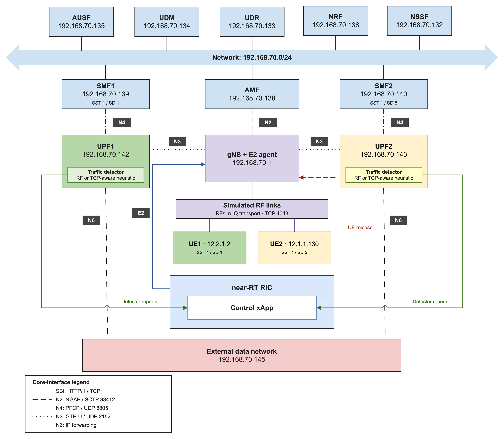

# Exploring the AI-RAN

In this experiment, you will bring up an end-to-end 5G network and follow an AI-assisted control loop. You will observe:

- how a near-real-time RAN Intelligent Controller (RIC) accepts an E2 connection from a gNB;
- how an xApp registers with that RIC and requests RAN slice-resource changes and UE release;
- how a pre-trained ML model supports an AI-for-RAN control loop in an O-RAN-enabled network.

**The main experiment explores AI/ML-driven anomaly detection and how it informs RAN slice-resource allocation and Radio Resource Control (RRC) connection-release decisions during a controlled denial-of-service (DoS) attack.** The initial connection/capture exercises establish how the system works. You will then perform **one Random Forest (RF) run and one heuristic run** on live traffic, using the heuristic as a rule-based baseline. You start the traffic and attack yourself, follow the resulting control actions, and compare the live measurements.

The experiment uses one POWDER d430 server and simulated RF links. Reserve the server in advance and complete the exercises during that reservation.

## Background



**O-RAN** exposes RAN functionality through programmable interfaces and
controllers. A near-RT RIC hosts or supports control applications called xApps. **AI-RAN** is broader: AI can optimize RAN operation, share infrastructure with RAN workloads, or support AI services through a RAN. This lab demonstrates **AI for RAN control**.

- **Denial-of-service (DoS) attack:** An attempt to make a network or service slow or unavailable to legitimate users, often by overwhelming it with traffic.
- **Network slicing:** Creating logical networks, called slices, on shared physical infrastructure, each with its own resource settings and service policies.
- **RRC connection release:** Ending a UE's active radio connection to the gNB, stopping its user-data traffic until it reconnects.

Here, a detector runs in each of the two custom UPF containers. In the first run, **both UPFs use the saved Random Forest** [[1]](#reference-1). In the second, **both UPFs use a TCP-aware
heuristic**. Each method classifies live traffic as normal or anomalous and reports counts to the same xApp. The xApp applies a fixed policy to those counts; the gNB enforces the requested resource quotas. This is the deployed inference-and-control part of an AI/ML workflow: capture traffic, extract features, classify packets, report the results, and observe the network's response to control actions. The pre-trained model stays fixed during the experiment. The heuristic run provides a non-ML baseline for the same loop. The roles of classification, decision-making, and enforcement are:

```text
UE traffic → UPF detector (classify) → xApp (decide) → RIC/E2 agent → gNB (enforce)
                                       └──────── telnet release request ────────┘
```

### How the attack, xApp, and heuristic work

**DoS workload.** UE1 is the traffic source under test; UE2 carries legitimate traffic. The live control-loop exercise uses a bounded SYN packet flood: UE1 sends zero-payload TCP SYN packets toward the lab DN at a requested 10,000 packets/s. This creates traffic and processing pressure on the shared radio/core path. We measure whether UE2's throughput and responsiveness degrade. Requested sending rate and achieved rate can differ.

**xApp policy.** Each UPF reports counts of normal/anomalous classifications. The two slices are configured before traffic starts. The xApp uses their anomaly ratios to adjust nominal physical resource block (PRB) allocation ratios. A fully anomalous 30-packet window can trigger a UE release through the separate telnet path. The same xApp policy is used in both comparison arms.

**What a UE release does.** A successful RRC Release removes the UE's active radio connection and interrupts its end-to-end user-data path through the gNB and UPF. Releasing UE1 therefore stops delivery of its attack traffic **and its legitimate traffic** over that connection. Reducing a slice quota changes its resource allocation; releasing the UE disconnects its active radio path. Correlate the release request with UE/gNB logs, traffic measurements, and reachability checks, and report any reconnection.

**Heuristic.** The rule labels a packet anomalous when it is TCP, has a payload of **at most 14 bytes**, and has either **SYN without ACK** or **RST** set. It uses the existing extracted protocol, flags, and byte counts, not the known attack IP, port, or scheduled start time. This is a fixed lab baseline; a small payload alone is not enough to trigger an anomalous label.

**Both the heuristic and RF report every computed window**:
30-packet windows with a ten-packet step (20 packets overlap). Legitimate connection attempts or resets can still trigger false alarms. The heuristic does not flag UDP/ICMP traffic or TCP packets outside its size/flag conditions.

## Run the experiment

### Reserve a server

You will need a [POWDER](https://powderwireless.net/) account with access to your
course project. Reserve the hardware several days before you plan to do the
lab. In the portal, choose **Experiments → Reserve Resources**, then:

- select the course project and the **Emulab** cluster;
- select **d430** hardware and request **one node**;
- leave the frequency range blank, since this experiment uses RFsim;
- choose a start and end time, allowing 6–12 hours for provisioning, compilation, the exercises, and troubleshooting;
- describe the purpose as learning about AI-RAN in your course.

Use **Check** to confirm availability, then submit the reservation request. Plan to finish and export your work during the reservation.

### Instantiate the profile

At your reservation time, open the instructor-provided POWDER profile link for **Exploring-the-AI-RAN**. Read the profile description and continue to the project selection page. Select your course project. On the schedule page, select your active reservation so the experiment ends within your reserved time, then finish instantiation.

Wait for the node to be **Ready** and its **Startup** state to be **Finished**. The startup service installs dependencies, places the repositories under `/opt`, and builds the software. Node allocation finishing does not mean compilation has finished.

Open **three SSH sessions** using the portal's SSH command: terminals 1 and 2 for captures/logs, and terminal 3 for startup/traffic.

### Start the core

In terminal 3:

```bash
sudo /opt/ai-ran/bin/start-core
```

Expected checkpoint from the startup helper:

```text
READY: 12 healthy core containers
```

List the running containers:

```bash
docker ps
```

Example output from `docker ps`:

```text
CONTAINER ID   IMAGE          COMMAND                  CREATED          STATUS                    PORTS                                    NAMES
3b80e797ac5c   2d70f1399931   "/openair-upf/bin/oa…"   20 seconds ago   Up 19 seconds (healthy)   2152/udp, 8805/udp, 8080/tcp             oai-upf-slice1
d1ab08642a37   8254e9b557c4   "/openair-upf/bin/oa…"   20 seconds ago   Up 19 seconds (healthy)   2152/udp, 8805/udp, 8080/tcp             oai-upf-slice2
6587a0ae0b7c   fd533bc2c096   "/openair-smf/bin/oa…"   20 seconds ago   Up 19 seconds (healthy)   80/tcp, 8080/tcp, 8805/udp               oai-smf-slice1
a02a730aadeb   fd533bc2c096   "/openair-smf/bin/oa…"   20 seconds ago   Up 19 seconds (healthy)   80/tcp, 8080/tcp, 8805/udp               oai-smf-slice2
819503e4411e   7e588f0fbfa7   "/openair-amf/bin/oa…"   20 seconds ago   Up 19 seconds (healthy)   80/tcp, 8080/tcp, 9090/tcp, 38412/sctp   oai-amf
2f7f6d6f4ca2   e4f211d9cc88   "/openair-ausf/bin/o…"   21 seconds ago   Up 20 seconds (healthy)   80/tcp, 8080/tcp                         oai-ausf
3b6ae61f341a   5361ca3c9a5b   "/openair-udm/bin/oa…"   21 seconds ago   Up 20 seconds (healthy)   80/tcp, 8080/tcp                         oai-udm
905a2f3d726a   53cdabbce16e   "/openair-nssf/bin/o…"   21 seconds ago   Up 20 seconds (healthy)   80/tcp, 8080/tcp                         oai-nssf
e83254004cc4   1571393477ab   "/openair-udr/bin/oa…"   21 seconds ago   Up 20 seconds (healthy)   80/tcp, 8080/tcp                         oai-udr
3c2924421d08   8d561faf9a13   "/openair-nrf/bin/oa…"   22 seconds ago   Up 22 seconds (healthy)   80/tcp, 8080/tcp, 9090/tcp               oai-nrf-slice12
5f6435dd748f   3f9ab2e401d2   "/bin/bash -c ' ipta…"   23 seconds ago   Up 22 seconds (healthy)                                            oai-ext-dn
a5e86a571a49   7dcddc01f13b   "docker-entrypoint.s…"   23 seconds ago   Up 23 seconds (healthy)   3306/tcp, 33060/tcp                      mysql
```

All twelve rows show running, healthy containers. Use `NAMES` to identify the services; `IMAGE` shows image IDs in this example. Your container IDs and elapsed times will differ. 

The custom UPFs already contain the model and original anomaly-detection scripts. The core uses two SMFs/UPFs with
distinct slices. 

The core separates control-plane functions from packet forwarding. Identify these roles in the container list:

| Component | Role in this experiment |
| --- | --- |
| AMF | Handles UE access and mobility signaling and the gNB's NGAP connection |
| SMFs | Manage the two slices' PDU sessions and configure their UPFs |
| UPFs | Forward user traffic; each custom container also runs a traffic detector |
| External DN | Provides the data-network endpoint used by the software UEs |

**Lab report:** save the command/output showing core health. Identify the AMF, NRF, two SMFs, two UPFs, and external-DN container. State which components run ML inference and which will enforce RAN changes.

### Observe gNB–RIC attachment

Start the RIC in terminal 3:

```bash
sudo /opt/ai-ran/bin/start-ric
sudo ss -lnp -A sctp
```

Before starting the gNB, capture in terminal 1:

```bash
sudo tcpdump -i lo -w /var/tmp/ai-ran/captures/connect-ric.pcap 'sctp port 36421'
```

Watch the RIC log in terminal 2:

```bash
tail -f /var/log/ai-ran/ric.log
```

Start the gNB in terminal 3:

```bash
sudo /opt/ai-ran/bin/start-gnb
```

Expected checkpoint:

```text
READY: gNB E2 setup and RRC module
```

After the gNB readiness message, wait two seconds, then stop the capture and log viewer with Ctrl+C
in their respective terminals. Inspect the saved capture:

```bash
tshark -r /var/tmp/ai-ran/captures/connect-ric.pcap -Y sctp
/opt/ai-ran/bin/inspect-control /var/tmp/ai-ran/captures/connect-ric.pcap
less /var/tmp/ai-ran/captures/connect-ric.pcap.messages.txt
```

Press `q` to exit `less`. The inspection helper uses this runtime's exact ASN.1
definitions. It shows frame numbers, message names, and full decoded XML; it
deduplicates SCTP retransmissions and reassembles DATA fragments.

There are two setup operations to distinguish. **SCTP** establishes the
transport association; **E2 Setup** exchanges the gNB identity and supported
RAN functions over that association. The SCTP handshake has four messages:

| Message | Direction | Purpose |
| --- | --- | --- |
| INIT | gNB → RIC | Requests an association and proposes transport parameters |
| INIT-ACK | RIC → gNB | Returns parameters and an integrity-protected state cookie |
| COOKIE-ECHO | gNB → RIC | Returns the cookie to the RIC |
| COOKIE-ACK | RIC → gNB | Confirms that the cookie was accepted |

The cookie lets the listener defer full association state until the peer returns
a valid token, helping resist spoofed connection requests. SCTP setup alone
does not establish that the E2 application exchange succeeded; find the E2
Setup request and response as well.

**Lab report:** show the SCTP INIT/INIT-ACK/COOKIE-ECHO/COOKIE-ACK exchange and
the E2 Setup request/response. Find the gNB identity and advertised RAN function
IDs in the decoded message. Match the identity to `/opt/ai-ran/etc/gnb.conf`.
Which function ID corresponds to RC in this deployment?

SCTP can bundle DATA with COOKIE-ECHO, so these need not occupy four separate
packets. Additional heartbeat paths can use other addresses on this same host;
they do not necessarily represent additional RIC instances.

### Attach both UEs and observe the data path

Capture in terminal 1:

```bash
sudo tcpdump -i demo-oai -w /var/tmp/ai-ran/captures/connect-ues.pcap 'sctp port 38412 or udp port 2152'
```

Start UE1, then UE2, in terminal 3:

```bash
sudo /opt/ai-ran/bin/start-ue1
sudo /opt/ai-ran/bin/start-ue2
sudo ip -n ue1 -br address
sudo ip -n ue2 -br address
```

Expected PDU addresses are UE1 `12.2.1.2` and UE2 `12.1.1.130`. Both namespaces
use the interface name `oaitun_ue1`. The scripts verify attachment and a DN ping.
Generate one additional exchange per UE:

```bash
sudo ip netns exec ue1 ping -c 1 192.168.70.145
sudo ip netns exec ue2 ping -c 1 192.168.70.145
```

Stop the capture with Ctrl+C. Inspect it:

```bash
tshark -r /var/tmp/ai-ran/captures/connect-ues.pcap -Y ngap
tshark -r /var/tmp/ai-ran/captures/connect-ues.pcap -Y 'gtp and icmp' -V
```

**Lab report:** show one UE's attachment-related NGAP exchange and one GTP-U
packet carrying ICMP. Identify outer tunnel endpoints and inner UE/DN IPs.
Explain why identical interface names in two namespaces do not conflict.

### Observe xApp–RIC registration

Capture in terminal 1:

```bash
sudo tcpdump -i lo -w /var/tmp/ai-ran/captures/connect-xapp.pcap 'sctp port 36422'
```

Start the xApp in terminal 3:

```bash
sudo /opt/ai-ran/bin/start-xapp
```

Expected checkpoint:

```text
READY: xApp E42 connection; awaiting detector clients
```

Wait two seconds after the readiness message, then stop the capture. Inspect it:

```bash
tshark -r /var/tmp/ai-ran/captures/connect-xapp.pcap -Y sctp
/opt/ai-ran/bin/inspect-control /var/tmp/ai-ran/captures/connect-xapp.pcap
less /var/tmp/ai-ran/captures/connect-xapp.pcap.messages.txt
```

Also inspect the xApp's log:

```bash
less /var/log/ai-ran/xapp.log
```

**Lab report:** show E42 Setup request/response, the assigned xApp ID, and the
registered E2 node information. Compare the 36421 and 36422 associations.
Why is the second association not another gNB attachment? Why should a generic
Wireshark installation not be assumed to decode this custom E42 extension?

On the validated TShark 3.6.2, port 36422 is interpreted as X2AP and may appear
as a `HandoverReport`. That label is misleading for this FlexRIC connection:
the pinned decoder and endpoint logs identify E42 Setup. There is no handover
to another gNB in this exercise. A port-based dissector guess is not proof of
the application protocol.

### Connect the detectors and observe initial slice control

Start these two captures before starting the detectors.

Terminal 1:

```bash
sudo tcpdump -i lo -w /var/tmp/ai-ran/captures/detector-control.pcap 'sctp port 36421 or sctp port 36422'
```

Terminal 2:

```bash
sudo tcpdump -i demo-oai -w /var/tmp/ai-ran/captures/detector-connect.pcap 'tcp port 8080 and host 192.168.70.1'
```

Terminal 3:

```bash
sudo /opt/ai-ran/bin/start-detectors
```

After the initial control acknowledgment, stop both captures. Inspect them:

```bash
tshark -r /var/tmp/ai-ran/captures/detector-connect.pcap -Y tcp
/opt/ai-ran/bin/inspect-control /var/tmp/ai-ran/captures/detector-control.pcap
less /var/tmp/ai-ran/captures/detector-control.pcap.messages.txt
```

The helper also decodes the nested RC control message. Parameter IDs 8 and 9
identify SST/SD, and ID 12 carries the dedicated PRB policy ratio. This branch
encodes SST/SD strings as ASCII OCTET STRINGs: hex `31` is `1`, and `35` is `5`.
The branch uses the dedicated ratio; do not infer enforcement of the unused
minimum/maximum ratio fields.

This initial 50/50 allocation is a configured default, not an inference result.
The next exercise observes changes driven by actual detector reports.

**Lab report:** identify both detector TCP connections, then follow the initial
control request from xApp to RIC and from RIC to gNB, including acknowledgments.
Find the two nominal 50/50 quotas. Request IDs can be translated between the
two interfaces; correlate endpoints, timing, service, and payload as well.

### RF run: operate the measurements and observe the AI loop

Use the network you just started with RF detectors in both UPFs; keep its actors
running. Stop the earlier captures and open a **fourth SSH terminal**. In this
run, trace how anomaly reports influence slice quotas and any UE-release action,
then relate those actions to the live measurements. The later heuristic run
provides a baseline using the same xApp policy. Each run includes a pre-attack
observation period.

| Terminal | Role during measurement |
| --- | --- |
| 1 | UE1 receiver: live throughput |
| 2 | UE2 receiver: live throughput |
| 3 | Docker stats: live UPF CPU and memory |
| 4 | Captures, traffic, attack launch, and xApp log |

Read the timed steps before starting traffic. Each run has 75 seconds of
background traffic and one 25-second attack. Keep the readouts visible and
note how they change before, during, and after the attack.

#### A. Prepare the result directory

In terminal 4:

```bash
sudo /opt/ai-ran/bin/prepare-rf-trial
```

This checks the running RF setup, records configuration/routes, and creates a
fresh result directory. It does **not** start traffic, captures, or an attack.
The fixed path `/var/tmp/ai-ran/captures/comparison/current` points to this run.
Previous runs are retained in timestamped directories.

#### B. Start the two receivers

In terminal 1:

```bash
sudo ip netns exec ue1 stdbuf -oL -eL iperf3 -s -1 -B 12.2.1.2 -p 80 -i 1 --forceflush -f m 2>&1 | /opt/ai-ran/bin/record-ue1-throughput
```

In terminal 2:

```bash
sudo ip netns exec ue2 stdbuf -oL -eL iperf3 -s -1 -B 12.1.1.130 -p 80 -i 1 --forceflush -f m 2>&1 | /opt/ai-ran/bin/record-ue2-throughput
```

Both should say they are listening on port 80. The recording helpers only
timestamp/save the output and display it; `iperf3` performs the measurement.

**Observe:** why can both servers bind port 80? Why will receiver-side goodput
be more informative than the sending-rate setting?

#### C. Observe UPF utilization

In terminal 3:

```bash
docker stats --format '{{json .}}' oai-upf-slice1 oai-upf-slice2 | /opt/ai-ran/bin/record-upf-cpu
```

You will see each UPF's CPU percentage and memory use. Record the idle values
before the traffic starts. This is container CPU utilization, the resource
metric used in paper Figure 7.

#### D. Start captures and legitimate traffic

In terminal 4, start these two bounded captures. `&` leaves them running while
you enter the next command; the two logs retain their capture/drop counts.

```bash
sudo timeout -s INT -k 3 95 tcpdump -i lo -n -U -w /var/tmp/ai-ran/captures/comparison/current/control.pcap 'sctp port 36421 or sctp port 36422 or tcp port 9090' > /var/tmp/ai-ran/captures/comparison/current/capture.log 2>&1 &
sudo timeout -s INT -k 3 95 tcpdump -i demo-oai -n -U -w /var/tmp/ai-ran/captures/comparison/current/detector-reports.pcap 'tcp port 8080 and host 192.168.70.1' > /var/tmp/ai-ran/captures/comparison/current/detector-capture.log 2>&1 &
```

Confirm both logs show `listening on` before proceeding:

```bash
cat /var/tmp/ai-ran/captures/comparison/current/capture.log
cat /var/tmp/ai-ran/captures/comparison/current/detector-capture.log
```

Run the following commands promptly, one by one. The first records a timestamp
only. The next three start the actual ping and TCP traffic:

```bash
sudo /opt/ai-ran/bin/mark-traffic-start
sudo ip netns exec ue2 ping -n -D -O -i 0.2 -W 1 -w 75 192.168.70.145 > /var/tmp/ai-ran/captures/comparison/current/ue2-ping.log 2>&1 &
sudo nsenter -t "$(docker inspect -f '{{.State.Pid}}' oai-ext-dn)" -n timeout -s INT -k 3 80 iperf3 -c 12.2.1.2 -p 80 --cport 20 -b 100M -l 1200 -t 75 -i 1 -J > /var/tmp/ai-ran/captures/comparison/current/ue1-sender.json 2>&1 &
sudo nsenter -t "$(docker inspect -f '{{.State.Pid}}' oai-ext-dn)" -n timeout -s INT -k 3 80 iperf3 -c 12.1.1.130 -p 80 --cport 80 -b 100M -l 1200 -t 75 -i 1 -J > /var/tmp/ai-ran/captures/comparison/current/ue2-sender.json 2>&1 &
```

`nsenter` runs the host's iperf client in the external DN's network namespace.
These are two **downlink** streams, each capped at a requested 100 Mbit/s, using
1,200-byte application write buffers. Actual goodput may be much lower.

**Observe for about 15–20 seconds:** watch both receiver rates and UPF CPU.
Read the latest classifications in terminal 4:

```bash
tail -n 12 /var/log/ai-ran/ads1.log
tail -n 12 /var/log/ai-ran/ads2.log
tail -n 12 /var/log/ai-ran/xapp.log
```

Record the pre-attack throughput, CPU, and nominal quotas. Are any legitimate
packets classified as anomalous? Do not assume the baseline must be perfect.

#### E. Launch the attack yourself

In terminal 4, while the two downlinks are still running:

```bash
( sudo /opt/ai-ran/bin/mark-attack-start && sudo ip netns exec ue1 timeout -s INT -k 3 25 hping3 -q -S -s 333 -k -p 333 -d 0 -i u100 -c 250000 -I oaitun_ue1 192.168.70.145 ) > /var/tmp/ai-ran/captures/comparison/current/attack.log 2>&1 &
tail -f /var/log/ai-ran/xapp.log
```

The marker records when you initiate the attack; Hping3 generates the packets.
This is the lab's adapted zero-payload SYN workload, not a literal repository
README attack command. Both methods use these same flags and destination.
Requested rate is 10,000 packets/s; achieved rate can differ. Exit 124 from
the timeout wrapper is expected.

**Observe during the attack:** compare the two receiver rates, UPF CPU, and
xApp messages. Look for quota changes and a release request. UE1 still has its
background TCP stream, so its detector can see a mixture of legitimate packets
and SYN traffic. A 100%-anomalous window and release are not guaranteed.

**Observe after the attack stops:** do UE2's throughput and CPU recover?
Does lower CPU mean protection succeeded, or could traffic have stalled?

#### F. Finish recording, then inspect

After the 75-second traffic runs, stop the log viewer with Ctrl+C in terminal 4
and run `wait` there. It waits for that terminal's bounded background jobs,
including the 95-second captures, to finish. Press Ctrl+C in terminals 1, 2,
and 3 if the receiver/CPU commands are still running.

```bash
wait
sudo /opt/ai-ran/bin/finish-trial
```

The helper saves actor logs and analyzes the recordings; it leaves the network
running for inspection. Check its coverage/error flags. It preserves missing
data and failed mitigation outcomes. If commands were started too late to cover
the baseline and attack windows, report the incomplete measurement.

```bash
cat /var/tmp/ai-ran/captures/comparison/current/attack.log
cat /var/tmp/ai-ran/captures/comparison/current/ue2-ping.log
/opt/ai-ran/bin/inspect-control /var/tmp/ai-ran/captures/comparison/current/control.pcap
less /var/tmp/ai-ran/captures/comparison/current/control.pcap.messages.txt
tshark -r /var/tmp/ai-ran/captures/comparison/current/detector-reports.pcap -q -z follow,tcp,ascii,0
tshark -r /var/tmp/ai-ran/captures/comparison/current/detector-reports.pcap -q -z follow,tcp,ascii,1
tshark -r /var/tmp/ai-ran/captures/comparison/current/control.pcap -q -z follow,tcp,ascii,0
```

Identify the detector stream order by endpoint and SST/SD. If no release request
occurred, the control capture may have no TCP stream to follow; record that
absence rather than assuming a release.

TCP payloads contain messages such as `sst:1,sd:1,normal:20,anomaly:10` and a
separate `rrc release_rrc 1` command. Port 8080 does not make this custom count
protocol HTTP or A1. The original reporting protocol lacks robust message
framing; correlate reconstructed bytes with endpoint logs.

The host and UPF containers may display different local timezones. Check them
before aligning log clock strings; frame-relative times and packet ordering
also help correlate the loop:

```bash
date -Is
docker exec oai-upf-slice1 date -Is
```

Check endpoint state and connectivity. Look for receipt of RRC Release in the
UE1 log and removal of its context in the gNB log. If the release succeeded and
the UE has not reconnected, UE1 should no longer deliver traffic to the DN;
UE2 should retain connectivity. A failed ping alone cannot distinguish release
from a zero quota or another failure, so use the endpoint logs as well:

```bash
less /var/log/ai-ran/ue1.log
less /var/log/ai-ran/gnb.log
sudo ip netns exec ue1 ping -c 3 -W 1 192.168.70.145
sudo ip netns exec ue2 ping -c 3 -W 1 192.168.70.145
```

**Lab report:** present an evidence chain with frame numbers and timestamps:
detector counts → xApp decision → E42/E2 control and ACK → telnet release
request → UE/gNB radio-state logs → continued UE2 connectivity. Show at least
one intermediate allocation and the final allocation if release occurs.

For each slice, the xApp begins with `floor(100 × (1 − anomaly_ratio))`; when
the total exceeds 100 it rescales and truncates again. Predict the output for
UE1 `(20 normal, 10 anomalous)` and UE2 `(30,0)`, then compare with a decoded
control message. Decreases and increases can appear in separate requests.
Explain why a 30-packet observation window can take seconds to fill even though
the controller is called a near-RT RIC.

Explain why a telnet command is not itself a decoded over-the-air RRC Release,
why a remaining TUN IP does not prove an active radio connection, and why
nominal quotas are not throughput measurements. If an expected event is absent,
report that absence and use the captures/logs to locate where the chain stopped.

### Heuristic run: repeat the same observations once

This second live run provides a rule-based baseline for the anomaly-driven RAN
control loop. Replace RF classification in **both UPFs** with our hand-written
TCP-aware rule, then repeat the workload and measurements. Use it to explain
how the choice of detector affects the same network's resource decisions, UE
connectivity, useful throughput, latency/loss, and UPF CPU cost.

#### What changes, and what stays the same?

| Part of the experiment | RF run | Heuristic run |
| --- | --- | --- |
| Classifier inside each UPF | Saved Random Forest and preprocessor | Fixed TCP/flags/byte-count rule |
| Traffic capture and feature extraction | Original UPF detector pipeline | Same pipeline |
| Observation window | 30 packets, advancing by 10 | Same window and step |
| Reporting | Normal/anomaly counts for every computed window | Same format and every-window reporting |
| xApp and enforcement | Fixed quota policy, E42/E2 controls, telnet release path | Same policy and paths |
| Offered workload | Two 75-second downlinks, UE2 ping, one 25-second UE1 SYN attack | Same commands, addresses, ports, and requested rates |

The heuristic wrapper replaces the classification function in the original
detector. It uses the existing extracted `protocol_type`, `flag`, `src_bytes`,
and `dst_bytes`; it does not use the extracted `service` feature. It has no
learned prediction model and does not adapt during the run. The xApp still
receives classification counts and applies its existing policy.

#### How the heuristic labels live packets

A packet is labeled **anomalous only when all three conditions hold**:

1. Its extracted protocol is TCP.
2. Its extracted `src_bytes + dst_bytes` is at most 28.
3. Its TCP flags contain **SYN without ACK**, or contain **RST** (with or without ACK).

All other packets are labeled normal by this rule. Here, `src_bytes` is the TCP
payload length and the existing extractor sets `dst_bytes = src_bytes`. Thus
the byte condition means **TCP payload length at most 14 bytes**, excluding
TCP/IP headers. It is not a measurement of bytes sent in two directions.

The code retains 28 from this lab's earlier connection-record baseline; that
calibration does not establish an optimal cutoff for this live TCP-only rule.

SYN initiates a TCP connection, ACK acknowledges traffic, and RST resets or
rejects a connection. Our attack sends zero-payload SYN packets, which match
the rule. The flag check lets ordinary short ACK packets pass, while short
connection attempts and resets are classified as anomalous. For example:

| Observed packet | Rule's label | Reason |
| --- | --- | --- |
| TCP SYN, 0-byte payload | Anomalous | Small connection attempt without ACK |
| TCP ACK, 4-byte payload | Normal | Neither SYN without ACK nor RST |
| TCP SYN/ACK, 0-byte payload | Normal | ACK excludes the SYN condition; no RST |
| TCP RST/ACK, 0-byte payload | Anomalous | RST satisfies the flag condition even with ACK |
| TCP SYN, 14-byte payload | Anomalous | Extracted byte sum is 28, exactly the inclusive cutoff |
| TCP SYN, 15-byte payload | Normal | Extracted byte sum is 30, above the cutoff |
| UDP or ICMP | Normal | The TCP condition fails |

This is a **per-packet signature**, not a SYN-rate meter or a tracker of completed
TCP handshakes. It does not use the known attack address, port 333, or attack
start time. Legitimate connection attempts and resets can therefore cause
false alarms, while attacks outside this narrow signature can be missed.
Keep the fixed rule throughout both measurements and record these limitations
when interpreting the live results.

Each UPF aggregates its labels into a 30-packet window and sends the normal and
anomalous counts over TCP port 8080. After each report, it discards the oldest
ten packets, retains twenty, and waits for ten new packets to complete the next
window. Reporting every window does **not** mean reporting at a fixed time
interval: packet arrival and processing speed determine when windows complete.
Mixed legitimate and attack packets can produce intermediate anomaly ratios
and quota changes; a release requires the xApp to receive a fully anomalous
window. Matching individual SYN packets does not guarantee an immediate release.

#### Restart with the heuristic detectors

Finish the RF recording and its inspection first. Then reset the topology so
the heuristic starts with fresh UE IDs, connections, and detector windows.
Run these startup commands one by one in terminal 4, checking readiness each time:

```bash
sudo /opt/ai-ran/bin/stop-lab
sudo /opt/ai-ran/bin/start-core
sudo /opt/ai-ran/bin/start-ric
sudo /opt/ai-ran/bin/start-gnb
sudo /opt/ai-ran/bin/start-ue1
sudo /opt/ai-ran/bin/start-ue2
sudo /opt/ai-ran/bin/start-xapp
sudo /opt/ai-ran/bin/start-heuristic-detectors
sudo /opt/ai-ran/bin/prepare-heuristic-trial
```

`start-core` also recreates the external DN's namespace to clear old TCP sockets
on the fixed measurement ports. The final command selects a new heuristic
result directory; the RF files are preserved.

Before starting the timed measurements, confirm the classifier and reporting
mode in **both** detector logs:

```bash
grep -E 'TCP_FLAG_HEURISTIC|REPORT_INTERVAL_SECONDS' /var/log/ai-ran/ads1.log /var/log/ai-ran/ads2.log
```

Both logs must identify `TCP_FLAG_HEURISTIC` and `REPORT_INTERVAL_SECONDS: 0.0`.
Zero means every computed window is reported. The xApp startup and initial
50/50 allocation should use the same control path you inspected in the RF run.

#### Repeat the workload and follow the control loop

Now repeat **[steps B–F of the RF run](#b-start-the-two-receivers) exactly once**, using the same four terminals
and the same commands. The `current` path now points to the heuristic run, so
you do not need to change any paths, traffic rates, ports, or attack flags.
Use approximately the same 15–20-second pre-attack observation time in both
runs, and record any timing deviations. Plot alignment does not remove every
effect of different pre-attack histories.

**Observe before the attack:** inspect both detector logs and the initial
throughput/CPU readings. Ordinary TCP setup can include SYN packets, so do not
assume all pre-attack labels will be normal. Do any false alarms cause quota
changes or a premature release?

**Observe during the attack:** follow UE1's counts, the xApp's quota decisions,
and any release request. Relate changes to UE2's goodput and RTT/loss and to
both UPFs' CPU use. Do the overlapping windows contain a mixture of legitimate
and attack traffic? Use the actual reports rather than assuming 100% anomaly.

**Observe after a release or the attack timeout:** distinguish a request from
a confirmed radio release. Check whether UE1's active data path is interrupted
and UE2 remains connected. A drop in UE1 throughput or UPF CPU can reflect the
loss of UE1's legitimate traffic as well as mitigation. Record any unintended
UE2 release, reconnection, stalled traffic, or absent release.

**Lab report:** explain the heuristic's three conditions and why the zero-payload
SYN attack matches them. Identify a legitimate packet it can misclassify and an
attack pattern it can miss. Using this run's captures and logs, trace one
detector report through the unchanged xApp policy to the observed quota or
release behavior. State which UE lost connectivity, if any, and how you verified
it. Relate these observations to the differences from your RF run.

### Put the two runs side by side

Use the pair to explain how detector output influenced slice-resource allocation
and UE-release behavior during the attack. The comparison connects the observed
control actions to UE2 service quality and UPF processing cost.

After both runs are finished, generate the table and plots:

```bash
sudo /opt/ai-ran/bin/plot-comparison
less /var/tmp/ai-ran/state/comparison.md
```

This command only processes saved recordings. It does not start another run.
The printed pair directory contains `comparison.md`, `summary.csv`,
`campaign.json`, PNG/SVG plots, and separate `rf/` and `heuristic/` evidence.
Export the bundle below to view the plots on your laptop.

Each method's baseline is the **ten seconds before its attack-start marker**.
The attack-period mean uses the **following 25 seconds**. Plots align the two
markers at zero, so human differences in launch time do not shift one trace
relative to the other. Ping loss covers the complete ping run. The report
flags insufficient coverage rather than treating missing observations as zero.
Plots also show the recorded post-traffic period, and the report lists release
request times, so a late unintended release is not hidden by the averaging window.

You have performed **one paired classroom demonstration: one run per method**.
There are no additional clean-control runs or repetitions; each run supplies
its own pre-attack baseline. This is enough to explain the behavior observed
in this lab, but not to establish repeatability or general superiority.

#### Interpret utilization correctly

- **Paper alignment:** Figure 7 measures CPU utilization of a UPF Docker
  container. We measure that resource, including the UPF and detector processes,
  for both UPFs. Our two conditions are AI and a heuristic; the paper's
  conditions are defense enabled/disabled. This is a metric-aligned extension,
  not an exact replication of its numerical results.
- **Container CPU:** the timestamped `docker stats` stream reports utilization.
  One fully busy logical CPU is 100%, matching Docker's Linux convention;
  a multithreaded container can exceed 100%. The
  paper does not specify its normalization. CPU utilization is not a direct
  power or energy measurement.
- **Quotas:** E2 PRB values are configured allocation policies, not the CPU
  utilization metric. Actual physical radio occupancy is outside this comparison.
- **Measurement scope:** each UPF's CPU includes forwarding and its detector's
  capture/extraction/classification/logging/reporting work, not inference alone.
- **Memory:** the plots use Docker CLI-reported container memory, including its
  cache adjustment. This is not an individual detector's resident-set size.
- **Missing values:** NA or gaps mean missing measurements, not zero load or
  zero latency. RTT describes received replies; always also report packet loss.

**Lab report:** present side-by-side throughput, RTT/loss, UPF CPU utilization,
and supplementary memory plots. Include both runs, their baselines, coverage flags,
and unintended releases. Use actual attack-onset events when discussing release
delay; time since capture start is not detection latency. Explain the measured
performance and compute-cost tradeoffs, and relate differences to classification,
processing, and the shared control policy. Higher utilization is not automatically
better: relate it to useful UE2 goodput and latency. Report ties and heuristic
wins as well as AI wins. State explicitly that this is one run per method.

### Export and stop

After stopping both captures, create an evidence bundle:

```bash
sudo /opt/ai-ran/bin/export-results
```

Run the printed `scp` command on your laptop. Use your portal's SSH hostname
if it shows a different alias. The bundle includes captures, decoded messages,
logs, and preparation provenance. Export it before the experiment expires.

On the node:

```bash
sudo /opt/ai-ran/bin/stop-lab
```

For another release trial, repeat the staged startup from `start-core` so UE
IDs are reset. Captures/logs are retained; a new capture with the same filename
will overwrite that capture, so export evidence before repeating it.

## Submit

Begin with an evidence-based explanation of the AI-for-RAN control loop during
the DoS attack: where classification occurs, how reports drive the xApp's policy,
and what changes the gNB actually enforces. Use the heuristic run as a baseline
when interpreting the RF run's behavior.

Submit your annotated architecture, connection sequences, classification/control
evidence chain, heuristic explanation, live AI-versus-heuristic comparisons
of throughput/latency/utilization, UE-release and connectivity evidence,
interpretation answers, source/profile revision,
packet captures, and relevant logs. Distinguish directly decoded messages, endpoint observations,
and conclusions. This is a single-node RFsim exploration, not an OTA or
production-security validation.

The workflow is inspired by Fraida Fund's
[Exploring the 5G core network](https://witestlab.poly.edu/blog/exploring-the-5g-core-network/).
Profile setup and operating notes are in [ai-ran/README.md](../ai-ran/README.md).

## References

<a id="reference-1"></a>**[1]** T. Tsourdinis, N. Makris, T. Korakis, and S. Fdida,
“AI-Driven Network Intrusion Detection and Resource Allocation in Real-World
O-RAN 5G Networks,” in *Proceedings of the 30th Annual International Conference
on Mobile Computing and Networking (ACM MobiCom)*, 2024, pp. 1842–1849.
[DOI: 10.1145/3636534.3697311](https://doi.org/10.1145/3636534.3697311).
[Code and saved model](https://github.com/teo-tsou/oai-anomaly-detection).
