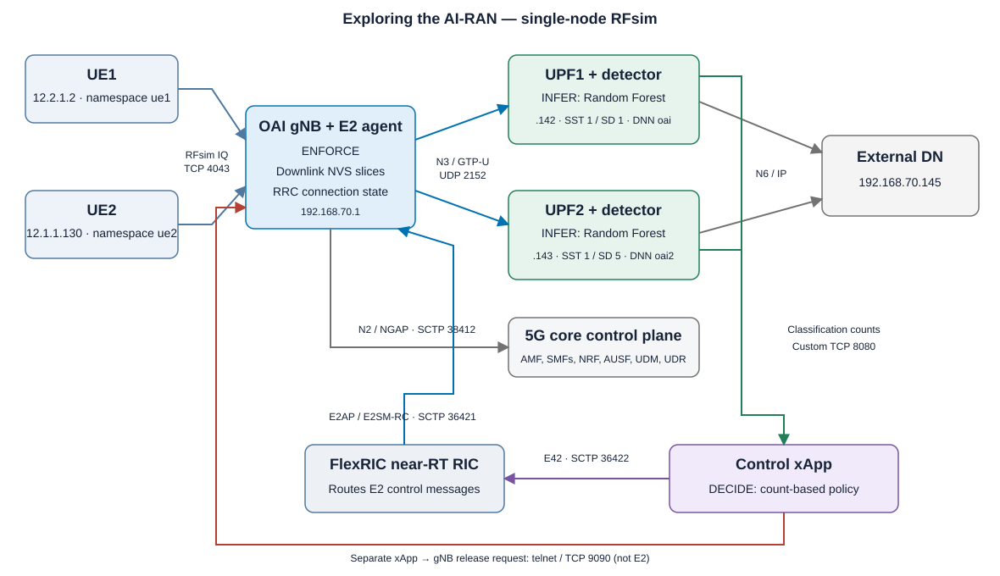

# Exploring the AI-RAN

In this experiment, you will bring up an end-to-end 5G network and follow an
AI-assisted control loop. You will observe:

- how a gNB connects to a near-real-time RAN Intelligent Controller (RIC);
- how an xApp registers with that RIC;
- how anomaly detectors in the UPFs send traffic classifications to the xApp;
- how the xApp changes RAN slice resources and requests a UE release;
- how packet captures and endpoint logs together establish what happened.
- how AI and a heuristic affect legitimate-user throughput,
  latency, and UPF container CPU utilization, with supplementary memory measurements.

**The main experiment is the AI-versus-heuristic comparison.** The initial
connection/capture exercises establish how the system works. You will then
compare classifiers offline and run matched live trials with automatic
measurement and plots. A working AI control loop alone does not answer the
comparison question.

The experiment uses one POWDER d430 server and simulated RF links. Reserve the
server in advance and complete the exercises during that reservation.

## Background



**O-RAN** exposes RAN functionality through programmable interfaces and
controllers. A near-RT RIC hosts or supports control applications called xApps.
**AI-RAN** is broader: AI can optimize RAN operation, share infrastructure with
RAN workloads, or support AI services through a RAN. This lab demonstrates
**AI for RAN control**, not every AI-RAN deployment model.

Here, the trained Random Forest runs in the two custom UPF containers. The C
xApp consumes its classifications and applies a deterministic policy. This
distinguishes inference from decision-making and enforcement:

```text
UE traffic → UPF detector (infer) → xApp (decide) → RIC/E2 agent → gNB (enforce)
                                  └──────── telnet release request ────────┘
```

| Connection | Implementation in this lab |
| --- | --- |
| gNB ↔ near-RT RIC | E2AP over SCTP, RIC port 36421 |
| xApp ↔ RIC | FlexRIC's custom E42 extension over SCTP, RIC port 36422 |
| UPF detectors → xApp | Custom count messages over TCP, host port 8080 |
| xApp → gNB release service | Separate telnet/TCP path, port 9090 |
| gNB ↔ core user plane | GTP-U over UDP, port 2152 |
| gNB ↔ AMF | NGAP over SCTP, port 38412 |
| gNB ↔ software UEs | RFsim software IQ transport, not over-the-air radio |

The detector socket is not a standardized A1/O2 implementation. RRC release is
not carried in the E2 control message in this prototype. The xApp is control-only;
do not assume it establishes a KPM/RC indication subscription.

### How the attack, xApp, and heuristic work

**DoS workload.** UE1 is the traffic source under test; UE2 carries legitimate
traffic. The introductory low-rate SYN command makes the control loop easy to
inspect. The later performance comparison uses a bounded SYN packet flood:
UE1 sends zero-payload TCP SYN packets toward the lab DN on port 333 at a
requested 10,000 packets/s. This creates traffic and processing pressure on the
shared radio/core path. We measure whether UE2's goodput and responsiveness
degrade; we do not assume that this closed-port workload exhausts a server's
TCP connection backlog. Requested sending rate and achieved rate can differ.

**xApp policy.** Each UPF reports counts of normal/anomalous classifications.
The xApp converts these ratios into nominal slice allocations, rescales if the
sum exceeds 100, and applies decreases before increases. A fully anomalous
30-packet window can trigger a UE release through the separate telnet path.
The same xApp policy is used in both comparison arms.

**Heuristic.** The fixed rule labels a record anomalous when
`src_bytes + dst_bytes <= 28`. The cutoff was calibrated on training records
before testing. In the live comparison it reports **at most once every ten
seconds**, starting with its first complete window, while RF reports every
computed window. Both use 30-packet windows advancing by ten packets. The
classifiers and reporting cadences differ, so the live comparison evaluates
the whole detection/reporting pipeline. The live extractor sets `dst_bytes = src_bytes`,
so the rule also flags ordinary small/empty packets such as TCP ACKs; the clean
controls expose that tradeoff. Do not tune the rule or omit unfavorable trials.

## Run the experiment

### Reserve and instantiate

Reserve **one d430 on the Emulab cluster** in your course project. Leave the
frequency reservation blank. Allow 6–12 hours for provisioning, compilation,
the exercises, and troubleshooting; cold preparation includes building OAI.

At your reservation time, open the instructor-provided POWDER profile link for
**Exploring-the-AI-RAN**, select the course project and reservation, and finish
instantiation. Wait for the node to be Ready **and Startup to finish**. The
profile installs packages/dependencies and places the repositories under `/opt`.

Use the portal's SSH command. Confirm preparation:

```bash
cat /opt/ai-ran/READY
```

Setup adds the node's existing regular login accounts to the `docker` group.
If you opened an SSH session before preparation finished, disconnect and
reconnect that session to load its new group membership. Verify Docker access:

```bash
docker info --format '{{.ServerVersion}}'
```

The lab uses fixed scripts with no student-selectable arguments. They start
background actors and return after readiness checks. Use **three SSH sessions**:
terminal 1 and terminal 2 for captures/logs, and terminal 3 for startup/traffic.
Ctrl+C stops a capture or log viewer, not the background network actors.

### Start the core

In terminal 3:

```bash
sudo /opt/ai-ran/bin/start-core
docker ps
```

Expect twelve running, healthy containers. The custom UPFs already contain the
model and original anomaly-detection scripts. The core uses two SMFs/UPFs with
distinct slices. NSSF is deployed, but this snapshot uses direct NRF discovery
for SMF selection in this fixed core configuration.

**Lab report:** save the command/output showing core health. Identify the AMF,
NRF, two SMFs, two UPFs, and external-DN container. State which components run
ML inference and which will enforce RAN changes.

### Observe gNB–RIC attachment

Start the RIC in terminal 3:

```bash
sudo /opt/ai-ran/bin/start-ric
sudo ss -lnp -A sctp
```

Before starting the gNB, capture in terminal 1:

```bash
sudo tcpdump -i lo -w /var/tmp/ai-ran/captures/connect-ric.pcap 'sctp port 36421'
```

Watch the RIC log in terminal 2:

```bash
tail -f /var/log/ai-ran/ric.log
```

Start the gNB in terminal 3:

```bash
sudo /opt/ai-ran/bin/start-gnb
```

After the gNB readiness message, wait two seconds, then stop the capture and log viewer with Ctrl+C
in their respective terminals. Inspect the saved capture:

```bash
tshark -r /var/tmp/ai-ran/captures/connect-ric.pcap -Y sctp
/opt/ai-ran/bin/inspect-control /var/tmp/ai-ran/captures/connect-ric.pcap
less /var/tmp/ai-ran/captures/connect-ric.pcap.messages.txt
```

Press `q` to exit `less`. The inspection helper uses this runtime's exact ASN.1
definitions. It shows frame numbers, message names, and full decoded XML; it
deduplicates SCTP retransmissions and reassembles DATA fragments.

**Lab report:** show the SCTP INIT/INIT-ACK/COOKIE-ECHO/COOKIE-ACK exchange and
the E2 Setup request/response. Find the gNB identity and advertised RAN function
IDs in the decoded message. Match the identity to `/opt/ai-ran/etc/gnb.conf`.
Which function ID corresponds to RC in this deployment?

SCTP can bundle DATA with COOKIE-ECHO, so these need not occupy four separate
packets. Additional heartbeat paths can use other addresses on this same host;
they do not necessarily represent additional RIC instances.

### Attach both UEs and observe the data path

Capture in terminal 1:

```bash
sudo tcpdump -i demo-oai -w /var/tmp/ai-ran/captures/connect-ues.pcap 'sctp port 38412 or udp port 2152'
```

Start UE1, then UE2, in terminal 3:

```bash
sudo /opt/ai-ran/bin/start-ue1
sudo /opt/ai-ran/bin/start-ue2
sudo ip -n ue1 -br address
sudo ip -n ue2 -br address
```

Expected PDU addresses are UE1 `12.2.1.2` and UE2 `12.1.1.130`. Both namespaces
use the interface name `oaitun_ue1`. The scripts verify attachment and a DN ping.
Generate one additional exchange per UE:

```bash
sudo ip netns exec ue1 ping -c 1 192.168.70.145
sudo ip netns exec ue2 ping -c 1 192.168.70.145
```

Stop the capture with Ctrl+C. Inspect it:

```bash
tshark -r /var/tmp/ai-ran/captures/connect-ues.pcap -Y ngap
tshark -r /var/tmp/ai-ran/captures/connect-ues.pcap -Y 'gtp and icmp' -V
```

**Lab report:** show one UE's attachment-related NGAP exchange and one GTP-U
packet carrying ICMP. Identify outer tunnel endpoints and inner UE/DN IPs.
Explain why identical interface names in two namespaces do not conflict.

### Observe xApp–RIC registration

Capture in terminal 1:

```bash
sudo tcpdump -i lo -w /var/tmp/ai-ran/captures/connect-xapp.pcap 'sctp port 36422'
```

Start the xApp in terminal 3:

```bash
sudo /opt/ai-ran/bin/start-xapp
```

Wait two seconds after the readiness message, then stop the capture. Inspect it:

```bash
tshark -r /var/tmp/ai-ran/captures/connect-xapp.pcap -Y sctp
/opt/ai-ran/bin/inspect-control /var/tmp/ai-ran/captures/connect-xapp.pcap
less /var/tmp/ai-ran/captures/connect-xapp.pcap.messages.txt
```

Also inspect the xApp's log:

```bash
less /var/log/ai-ran/xapp.log
```

**Lab report:** show E42 Setup request/response, the assigned xApp ID, and the
registered E2 node information. Compare the 36421 and 36422 associations.
Why is the second association not another gNB attachment? Why should a generic
Wireshark installation not be assumed to decode this custom E42 extension?

On the validated TShark 3.6.2, port 36422 is interpreted as X2AP and may appear
as a `HandoverReport`. That label is misleading for this FlexRIC connection:
the pinned decoder and endpoint logs identify E42 Setup. There is no handover
to another gNB in this exercise. A port-based dissector guess is not proof of
the application protocol.

### Connect the detectors and observe initial slice control

Start these two captures before starting the detectors.

Terminal 1:

```bash
sudo tcpdump -i lo -w /var/tmp/ai-ran/captures/detector-control.pcap 'sctp port 36421 or sctp port 36422'
```

Terminal 2:

```bash
sudo tcpdump -i demo-oai -w /var/tmp/ai-ran/captures/detector-connect.pcap 'tcp port 8080 and host 192.168.70.1'
```

Terminal 3:

```bash
sudo /opt/ai-ran/bin/start-detectors
```

After the initial control acknowledgment, stop both captures. Inspect them:

```bash
tshark -r /var/tmp/ai-ran/captures/detector-connect.pcap -Y tcp
/opt/ai-ran/bin/inspect-control /var/tmp/ai-ran/captures/detector-control.pcap
less /var/tmp/ai-ran/captures/detector-control.pcap.messages.txt
```

The helper also decodes the nested RC control message. Parameter IDs 8 and 9
identify SST/SD, and ID 12 carries the dedicated PRB policy ratio. This branch
encodes SST/SD strings as ASCII OCTET STRINGs: hex `31` is `1`, and `35` is `5`.
The branch uses the dedicated ratio; do not infer enforcement of the unused
minimum/maximum ratio fields.

This initial 50/50 allocation is a configured default, not an inference result.
The next exercise observes changes driven by actual detector reports.

**Lab report:** identify both detector TCP connections, then follow the initial
control request from xApp to RIC and from RIC to gNB, including acknowledgments.
Find the two nominal 50/50 quotas. Request IDs can be translated between the
two interfaces; correlate endpoints, timing, service, and payload as well.

### Observe the AI loop

Start a control capture in terminal 1:

```bash
sudo tcpdump -i lo -w /var/tmp/ai-ran/captures/ai-control.pcap 'sctp port 36421 or sctp port 36422 or tcp port 9090'
```

Start a report/user-plane capture in terminal 2:

```bash
sudo tcpdump -i demo-oai -w /var/tmp/ai-ran/captures/ai-traffic.pcap '(tcp port 8080 and host 192.168.70.1) or udp port 2152'
```

In terminal 3, generate normal ICMP traffic from both UEs:

```bash
sudo /opt/ai-ran/bin/send-normal
```

Read the reports in the logs:

```bash
less /var/log/ai-ran/ads1.log
less /var/log/ai-ran/ads2.log
less /var/log/ai-ran/xapp.log
```

Expect 30-packet normal windows and nominal 50/50 allocation. The window
advances by ten packets. Now run the repository's original small Hping3 command
for a fixed 25 seconds, while UE2 continues normal ICMP traffic:

```bash
sudo /opt/ai-ran/bin/run-attack
```

The wrapper uses the original arguments
`hping3 -S -d 100 -a 12.2.1.2 12.2.1.1`, inside UE1, with a finite timeout.
It is deliberately low-rate for inspecting the loop, not a saturated DoS
performance benchmark. Both detectors need traffic for fresh xApp decisions.

After the traffic script finishes, stop both captures. Inspect the sequence:

```bash
/opt/ai-ran/bin/inspect-control /var/tmp/ai-ran/captures/ai-control.pcap
less /var/tmp/ai-ran/captures/ai-control.pcap.messages.txt
tshark -r /var/tmp/ai-ran/captures/ai-traffic.pcap -Y 'tcp.port == 8080 and tcp.len > 0' -V
tshark -r /var/tmp/ai-ran/captures/ai-control.pcap -Y 'tcp.port == 9090 and tcp.len > 0' -V
```

Read the two detector conversations as text. Because this capture starts before
normal traffic and before the attack, its first two TCP streams are the detector
streams; use the endpoints and SST/SD fields to identify their order:

```bash
tshark -r /var/tmp/ai-ran/captures/ai-traffic.pcap -q -z follow,tcp,ascii,0
tshark -r /var/tmp/ai-ran/captures/ai-traffic.pcap -q -z follow,tcp,ascii,1
tshark -r /var/tmp/ai-ran/captures/ai-control.pcap -q -z follow,tcp,ascii,0
```

TCP payloads contain messages such as `sst:1,sd:1,normal:20,anomaly:10` and a
separate `rrc release_rrc 1` command. Port 8080 does not make this custom count
protocol HTTP or A1. The original reporting protocol lacks robust message
framing; correlate reconstructed bytes with endpoint logs.

The host and UPF containers may display different local timezones. Check them
before aligning log clock strings; frame-relative times and packet ordering
also help correlate the loop:

```bash
date -Is
docker exec oai-upf-slice1 date -Is
```

Check endpoint state and connectivity:

```bash
less /var/log/ai-ran/ue1.log
less /var/log/ai-ran/gnb.log
sudo ip netns exec ue1 ping -c 3 -W 1 192.168.70.145
sudo ip netns exec ue2 ping -c 3 -W 1 192.168.70.145
```

**Lab report:** present an evidence chain with frame numbers and timestamps:
detector counts → xApp decision → E42/E2 control and ACK → telnet release
request → UE/gNB radio-state logs → continued UE2 connectivity. Show at least
one intermediate allocation and the final allocation if release occurs.

For each slice, the xApp begins with `floor(100 × (1 − anomaly_ratio))`; when
the total exceeds 100 it rescales and truncates again. Predict the output for
UE1 `(20 normal, 10 anomalous)` and UE2 `(30,0)`, then compare with a decoded
control message. Decreases and increases can appear in separate requests.
Explain why a 30-packet observation window can take seconds to fill even though
the controller is called a near-RT RIC.

Explain why a telnet command is not itself a decoded over-the-air RRC Release,
why a remaining TUN IP does not prove an active radio connection, and why
nominal quotas are not throughput measurements. If an expected event is absent,
report that absence and use the captures/logs to locate where the chain stopped.

### Compare AI and the heuristic on held-out records

```bash
/opt/ai-ran/bin/compare-models
```

This evaluates the unchanged RF and the fixed byte rule on the same 22,544
held-out records, without retraining or using the test labels to select the
threshold. It prints both confusion matrices, accuracy, balanced accuracy,
attack precision/recall/F1, and normal false-positive rate. The ten-second
reporting delay has no effect on these offline predictions.

**Lab report:** name the five features and the component performing inference.
Explain why this offline accuracy is not a measured live-packet accuracy, and
why changing quotas does not mean the model learned online. Identify one
limitation of feature extraction or the two-client controller. Compare both
methods on every reported metric: does the better method depend on the metric?

### Main experiment: compare throughput, latency, and utilization

Stop the manual captures and retain their files. Run the fixed paired experiment:

```bash
sudo /opt/ai-ran/bin/run-comparison
```

Allow approximately 30–45 minutes, including repeated startup and measurement.
The runner preserves the preceding evidence, then resets the DN, core, radio,
xApp, and detector state for each trial. It runs one clean control per method
and three attack pairs in alternating order: RF/heuristic, heuristic/RF,
RF/heuristic. All outcomes are retained, including unintended releases,
incomplete measurements, no mitigation, and runtime faults.

| Setting | Fixed value |
| --- | --- |
| Measurement workload | 50 seconds, two TCP downlink streams capped at 100 Mbit/s each |
| Throughput source | Actual receiver-side iperf3 intervals in each UE namespace |
| Latency/loss | UE2 ICMP probes every 0.2 seconds |
| Attack trials | Same bounded UE1 SYN workload, beginning near t=15 s |
| Clean trials | Identical legitimate workload, no attack |
| Main comparison window | [15,48) seconds; includes the response period |
| Additional windows | Baseline [5,15), post-event [20,48), late [25,48) seconds |
| Detector difference | RF every window versus fixed byte rule with ten-second reporting |
| Utilization (paper Figure 7 metric) | CPU time of each complete UPF Docker container, including its detector |
| Supplementary compute measurements | Host/process CPU counters, container memory, and detector RSS |

The comparison workload is intentionally distinct from the earlier low-rate
packet walkthrough. That walkthrough does not substitute for an RF performance
trial, since it did not run the same throughput load and measurement schedule.

When the runner finishes, read its table:

```bash
less /var/tmp/ai-ran/state/comparison.md
```

It prints the timestamped evidence directory under `/var/tmp/ai-ran/captures/`.
That directory contains `comparison.md`, `summary.csv`, `campaign.json`, raw
per-trial data/captures/logs, and PNG/SVG plots for throughput, latency, UPF CPU
utilization, and detector memory. Export the bundle below and
open the plots on your laptop. The runner leaves the network stopped.

#### Interpret utilization correctly

- **Paper alignment:** Figure 7 measures CPU utilization of a UPF Docker
  container. We measure that resource, including the UPF and detector processes,
  for both UPFs. Our two conditions are AI and a heuristic; the paper's
  conditions are defense enabled/disabled. This is a metric-aligned extension,
  not an exact replication of its numerical results.
- **Container CPU:** consecutive cgroup CPU-time counters divided by elapsed
  wall time give utilization. One fully busy logical CPU is 100%, matching
  Docker's Linux convention; a multithreaded container can exceed 100%. The
  paper does not specify its normalization. CPU utilization is not a direct
  power or energy measurement.
- **Quotas:** E2 PRB values are configured allocation policies, not the CPU
  utilization metric. Actual physical radio occupancy is outside this comparison.
- **CPU:** host CPU is a percentage of the whole machine; each process is a
  percentage of one logical CPU. The two detector CPU values are summed and
  may exceed 100%. This measures capture/extraction/classification/logging and
  reporting overhead together, not inference alone.
- **Memory:** host usage is `MemTotal - MemAvailable`; container cgroup memory
  includes cache; detector memory sums their resident sets. Shared pages may be
  counted twice in that sum.
- **Missing values:** NA or gaps mean missing measurements, not zero load or
  zero latency. RTT describes received replies; always also report packet loss.

**Lab report:** present side-by-side throughput, RTT/loss, UPF CPU utilization,
and supplementary memory plots. Include all three pairs, clean controls, coverage flags,
and unintended releases. Use actual attack-onset events when discussing release
delay; time since capture start is not detection latency. Explain whether AI's
advantages justify its compute cost, and whether differences come from the rule,
reporting cadence, or control policy. Higher utilization is not automatically
better: relate it to useful UE2 goodput and latency. Report ties and heuristic
wins as well as AI wins. Three pairs are descriptive observations, not a
statistical guarantee of superiority.

### Export and stop

After stopping both captures, create an evidence bundle:

```bash
sudo /opt/ai-ran/bin/export-results
```

Run the printed `scp` command on your laptop. Use your portal's SSH hostname
if it shows a different alias. The bundle includes captures, decoded messages,
logs, and preparation provenance. Export it before the experiment expires.

On the node:

```bash
sudo /opt/ai-ran/bin/stop-lab
```

For another release trial, repeat the staged startup from `start-core` so UE
IDs are reset. Captures/logs are retained; a new capture with the same filename
will overwrite that capture, so export evidence before repeating it.

## Submit

Submit your annotated architecture, connection sequences, inference/control
evidence chain, offline classifier table, live AI-versus-heuristic comparisons
of throughput/latency/utilization, interpretation answers, source/profile revision,
packet captures, and relevant logs. Distinguish directly decoded messages, endpoint observations,
and conclusions. This is a single-node RFsim exploration, not an OTA or
production-security validation.

The workflow is inspired by Fraida Fund's
[Exploring the 5G core network](https://witestlab.poly.edu/blog/exploring-the-5g-core-network/).
The implementation builds on Tsourdinis et al.'s
[AI-driven O-RAN experiment](https://doi.org/10.1145/3636534.3697311).
Profile setup and operating notes are in [ai-ran/README.md](../ai-ran/README.md).
